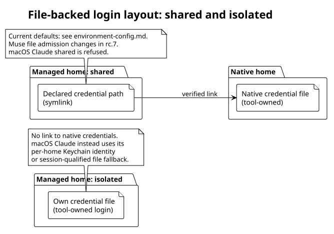
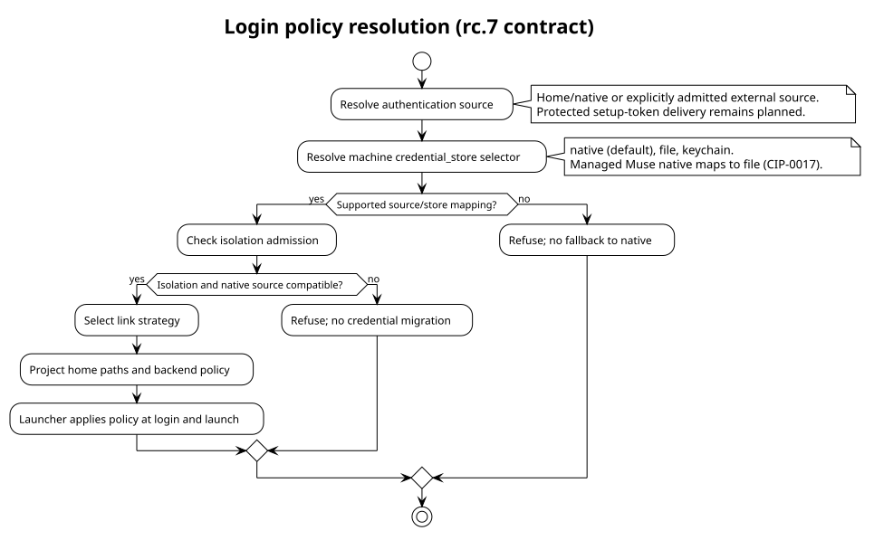
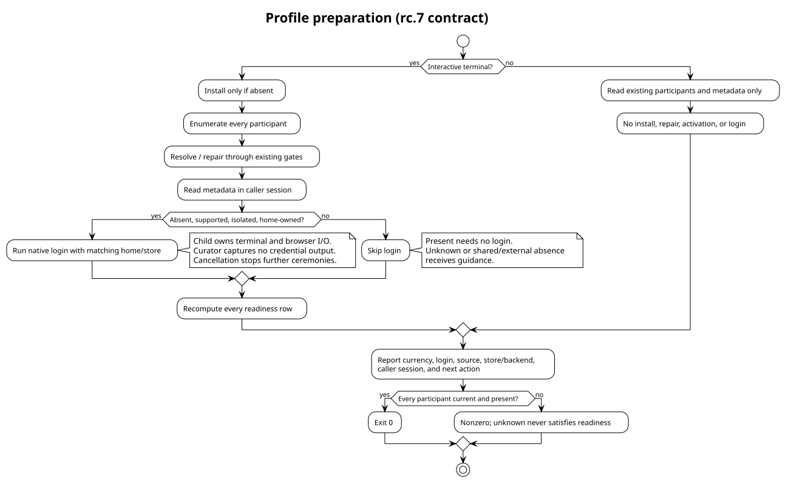

# Agent logins

Curator gives each profile a managed agent home. The agent tool owns
the login inside that home or in its selected operating-system store.
Choose the store and isolation before preparing a home for launches.

## Availability

This reference checks Curator `main` at `205272e7` on 2026-10-16.
**works today** means implemented there. **rc.7** identifies the next
implementation contract; those commands are unavailable on this baseline.
**planned** identifies a proposed capability with no implementation claim.
The measurements below came from scratch homes on 2026-10-14.
They describe the named tool releases, without claiming later versions
behave identically.

| Capability | Status | Bound |
|---|---|---|
| `isolation.<profile>.<env-id>` and credential links | works today | Follow the existing per-tool admission table linked below. |
| `env resolve --format shell`, followed by the tool's login | works today | Login must use the same home and session kind as the launcher. |
| `credential_store.<profile>.<env-id>` | rc.7 | Machine-owned selector; unsupported mappings refuse. |
| `curator env login` and `curator profile prepare` | rc.7 | Interactive login requires a real terminal. |
| `login: present \| absent \| unknown` readiness row | rc.7 | Metadata only; presence does not prove successful authentication. |
| Codex typed `-c` settings and store overrides | rc.7 | The launcher applies overrides without rewriting `config.toml`. |
| Managed Muse file selection and explicit `root_context` fragment | rc.7 | File mode admits shared and isolated homes; refresh writes remain unmeasured. |
| Managed-home snapshots through `env materialize` | rc.7 | Readiness never authorizes copying credentials into an archive. |
| Protected Claude `setup-token` source and executor injection | planned | Inference only; Remote Control refuses this token. |

## Where the tools keep a login

A native home is the tool's ordinary home before Curator exports any
managed-home variables. A managed home is the profile-specific home selected
by `env resolve`. Paths below use environment variables or home-relative
names; they identify storage contracts, not a particular machine.

### Claude Code

Claude Code `2.1.299` chooses storage by session capability on macOS 15.
Desktop and ssh are descriptions of the measured sessions. A daemon or
tmux server inherits the capabilities of the session that started it.
Transport alone does not establish Keychain access.

| Platform/session | Store and observation | Status |
|---|---|---|
| macOS 15, session with login-Keychain access | A per-home Keychain item, `Claude Code-credentials-<hash>`. The hash is the first eight lowercase hex characters of SHA-256 of the exact `CLAUDE_CONFIG_DIR` string. Login writes no credential file and leaves the native login untouched. | works today |
| macOS 15, ssh-started session without Keychain access | `$CLAUDE_CONFIG_DIR/.credentials.json`, mode `0600`. `security show-keychain-info` exited `36` in the measured session. Login wrote no Keychain item; hiding the file yielded "Not logged in". | works today |
| macOS 15, user with no login Keychain | Login fails with "Couldn't save your login". This case has no file fallback. It differs from a session that lacks access to an existing login Keychain. | works today |
| Linux, home-file backend | `$CLAUDE_CONFIG_DIR/.credentials.json`. Curator can link this file in shared mode. The supplied Claude Code `2.1.299` source pack records this layout without a Linux distribution or session probe matrix. | works today |

The two measured macOS stores do not see each other. A desktop login
reported `loggedIn=false` in the ssh-started session, and the reverse also
held. Log in from the same kind of session as the launcher. Repeat the
readiness check when that session changes.

Claude Code `2.1.299` also accepts `CLAUDE_CODE_OAUTH_TOKEN` from
`claude setup-token`. It reports `authMethod=oauth_token`, takes precedence
over the home's login, and writes nothing to either store. The vendor
mechanism **works today**; Curator's protected enrollment and delivery
remain **planned**. Remote Control refuses this inference-only source.
`claude auth status --json` reports `loggedIn` and `authMethod` without
a model call on this measured release.

### Codex CLI

Codex CLI `0.153.2` selects storage through `cli_auth_credentials_store`
in `config.toml`. The supplied measurement does not include separate
macOS and Linux keyring qualification or vendor failure messages.

| Platform/selection | Store and observation on Codex CLI `0.153.2` | Status |
|---|---|---|
| macOS or Linux, selector absent or `file` | `$CODEX_HOME/auth.json`; absence selects `file`. Curator's native file-sharing route is available. | works today |
| macOS or Linux, `keyring` or `auto` | Uses the OS keyring when available. Backend availability and session access matter; a working desktop keyring does not establish ssh access. Curator refuses isolated mode for either selector. | works today |
| Per-invocation `-c 'cli_auth_credentials_store="file"'` | The CLI override wins over `config.toml` for that invocation. This is an existing vendor interface. | works today |
| Curator-selected file/keyring override at login and launch | The launcher transports the machine selection with typed `-c` arguments. | rc.7 |

Curator currently follows the **native** `config.toml` selector. A
different selector in the managed `config.toml` does not change Curator's
link strategy. Curator rewrites neither file. Native `keyring` has no
credential link; `auto` retains a file link for fallback but can use an
ambient keyring login. Isolated `keyring` or `auto` refuses with
`environment_isolated_unsupported`. An unknown native selector refuses
with `environment_credential_unsupported`; an unreadable or malformed
native configuration fails resolution, rather than selecting the default.

The [official OpenAI authentication reference](https://developers.openai.com/codex/auth)
describes file and keyring storage. The versioned observations above remain
the baseline for this document.

### Muse

Muse `1.4.8` on macOS uses a global Keychain item by default.
The measurement identifies the item as `ai.meta.dev.credentials`.
An `auth.json` link alone cannot select the file backend.

| Platform/selection | Store and observation on Muse `1.4.8` | Status |
|---|---|---|
| macOS, native selection | Global Keychain with `auth.json` as a fallback. Session metadata names `keychain`, `keychain_fallback_file`, or `file`. Desktop versus ssh behavior was not separately qualified. | works today |
| macOS, no Keychain | OAuth succeeds but saving fails with "keychain write failed (os status -60006)"; login exits `1`. The measured failure has no file fallback. | works today |
| macOS, `TBH_CREDENTIAL_BACKEND=file` | `$XDG_CONFIG_HOME/muse/auth.json`, mode `0600`; later runs use `file` with zero Keychain access. Hiding the file yields missing credentials. A linked `auth.json` also works. | works today |
| Linux | The file contract uses `$XDG_CONFIG_HOME/muse/auth.json`. The source pack contains no Muse `1.4.8` Linux login probe or measured error message; backend behavior remains unqualified there. | rc.7 (Curator contract; Linux vendor measurement absent) |
| Managed Muse, file backend applied at login and launch | Both shared and isolated homes are admitted through `TBH_CREDENTIAL_BACKEND=file`. | rc.7 |

Muse `1.4.8` accepts a minted API key through `exec --api-key-stdin`;
the measured request bills the subscription. `META_API_KEY` leaves the
store untouched. These vendor routes **work today**. Token-refresh writes
and concurrent refresh behavior remain unmeasured. File admission in rc.7
does not establish those properties.

The diagram summarizes measured stores and the Linux evidence limit:


## Isolation

Isolation selects whose login a home uses. The machine knob
`isolation.<profile>.<env-id>` accepts `shared` or `isolated`.
Shared homes link the declared credential file to the native file.
Isolated homes keep their own login and create no credential link.
Ambient keyrings can prevent isolation even when homes differ.

The [existing isolation table](environment-config.md#logging-in-to-managed-homes)
is the reference for current defaults and admission. It covers each
environment without duplicating the table here. In particular, macOS
Claude defaults to isolated and refuses shared with
`environment_shared_unsupported`. Muse isolated remains refused on the
current baseline; the rc.7 file contract changes that admission.

The layout below applies to file-backed logins. Claude's macOS Keychain
login instead belongs to the managed home's exact config-directory identity:



## Credential store (rc.7)

The machine selects where a tool stores its login. The exact knob is
`credential_store.<profile>.<env-id>`, with values `native`, `file`, and
`keychain`. Its default is `native`. This knob is **rc.7**, unavailable
on the checked baseline.

For profile `P`, select Codex file storage in rc.7 with:

```bash
curator env config set credential_store.P.codex_cli file
```

The general CLI spelling is
`curator env config set credential_store.<profile>.<env-id> <value>`.
The operator owns this machine setting. Packages, overlays, system locks,
and repositories never select the store. Keychain availability and session
capabilities belong to the machine. A package must not decide that login
tokens go to disk.

| Adapter | `native` | `file` | `keychain` | Status |
|---|---|---|---|---|
| Codex | Follow native `config.toml`; absent means file; no override. | `-c 'cli_auth_credentials_store="file"'` at login and launch. | `-c 'cli_auth_credentials_store="keyring"'` only on a qualified macOS backend; otherwise refuse. Isolated remains refused. | rc.7 |
| Muse | For managed Muse, resolve to effective file under CIP-0017. Preserve the stored `native` default. | `TBH_CREDENTIAL_BACKEND=file` at login and launch. | Refuse; no qualified force-Keychain interface. | rc.7 |
| Claude | Use the session-qualified native choice. | Refuse; no established force-file interface. | Refuse; no established force-Keychain interface. | rc.7 |

CIP-0017 explicitly changes CIP-0015's generic Muse native mapping.
An unset or `native` selector becomes effective `file` for managed Muse
in rc.7. The vendor's ordinary native login remains Keychain-backed on
the measured macOS release. Shared Muse therefore requires a native
**file-backed** login; a Keychain-only login is insufficient.

Changing the selector never migrates or deletes a login. Inspect and
explicitly migrate a recorded backend or link conflict before launching.
Repair cannot silently change credential ownership. Shared Codex file
storage requires a compatible native file source; an old `auth.json`
under native `keyring` or `auto` is not a shared login source.

Curator resolves source, then store, then isolation admission, then link
strategy. Unsupported selections refuse instead of falling back:



## Login routes

### Resolve and log in (works today)

For an installed, current Claude home, resolve and log in from the
same kind of session as the launcher:

```bash
eval "$(curator env resolve claude_code --profile P --format shell)"
claude auth login
claude auth status --json
```

The export selects `CLAUDE_CONFIG_DIR` for profile `P`. Check that resolve
succeeds before running login. A stale home needs explicit resolution or
repair first. The status command is a vendor check, separate from Curator's
planned metadata-only readiness row.

### Login and prepare (rc.7)

`curator env login` runs the tool's own login inside a current, trusted
managed home. It supports Claude, Codex and Muse. It requires isolated,
home-owned authentication and terminal input and output. Shared mode refuses
with native-login guidance. The command never installs, repairs, migrates,
or activates a profile, and never captures credential-bearing output.

After selecting isolated mode and a supported store, log in with:

```bash
curator env login codex_cli --profile P
```

The child uses the same home and store projection as later launches.
Curator recomputes readiness after the child exits.

To prepare every participating environment in rc.7, run:

```bash
curator profile prepare P
```

Prepare installs only an absent profile. Existing locks and current-profile
selections remain intact. It resolves every participant and starts login
only for absent, supported, isolated, home-owned sources. Present rows skip
login; unknown rows receive guidance and never trigger a login attempt.
Non-interactive prepare is report-only: it performs no install, repair,
browser interaction, or login.

| Readiness row | Meaning | Status |
|---|---|---|
| `present` | Accessible candidate established from metadata in the caller's session. | rc.7 |
| `absent` | Successful inspection found no candidate. | rc.7 |
| `unknown` | Inspection was inaccessible, ambiguous, untrusted, or unqualified. Read failure never means absence. | rc.7 |

Readiness contains no token bytes or account identities. A present row
does not prove validity, expiry, scope, refresh safety, or inference.
Ordinary status can display absent or unknown rows. In rc.7,
`env status --check` and prepare succeed only when every participant is
current and present. Ambient OpenCode remains unknown and therefore
prevents aggregate success. Existing currency-only scripts must account
for this stricter check; launch gains no new readiness gate.

The preparation flow keeps unknown evidence separate from absence:



### Protected setup-token source (planned)

CIP-0010 proposes enrolling a Claude `setup-token` once in a protected
per-user store under an authentication node. An opaque `source_ref`
identifies the source. Only the final executor injects
`CLAUDE_CODE_OAUTH_TOKEN`; plans and fragments never carry its value.
Inherited authentication removes the per-home login requirement and the
macOS desktop/ssh storage split. It also serves users without a Keychain.
This path supports inference; Remote Control still requires another login
route. No Curator enrollment command is available on the checked baseline.

## Recipes

### macOS desktop (works today)

Use the resolve-and-login Claude recipe above in a desktop terminal.
Start subsequent launches from a session with the same Keychain capability.
For Codex CLI `0.153.2` with native file storage, log in natively;
Curator's default shared home links `auth.json`. For Muse `1.4.8`, a native
Keychain login alone does not establish file-backed sharing. The managed
file selector and isolated Muse preparation arrive in rc.7.

### macOS over ssh (works today; planned alternative)

Run the Claude recipe in the ssh session that will start launches.
Claude Code `2.1.299` uses the home's credential file in the measured
session without Keychain access. A desktop login alone is insufficient.
If the user has no login Keychain at all, native login fails; forcing
Claude file storage is unsupported. The protected setup-token source is
the **planned** inference alternative. For Codex, use a native file login
instead of assuming a desktop keyring is accessible.

### Linux server (works today; rc.7 preparation)

Claude's default shared mode reuses the native `.credentials.json` file.
Codex's native `file` mode reuses `auth.json`. Perform the native login
before resolving a shared home. For a separate Codex login in rc.7, choose
both isolation and storage before login:

```bash
curator env config set isolation.P.codex_cli isolated
curator env config set credential_store.P.codex_cli file
curator env login codex_cli --profile P
```

Resolve or repair the home explicitly before `env login` when needed.
For Muse, rc.7 selects the file contract; Linux behavior still needs a
versioned vendor probe. On a qualified file backend, prepare a shared
native Muse login before applying managed XDG exports:

```bash
TBH_CREDENTIAL_BACKEND=file muse login
```

This vendor command selects file storage. It does not by itself qualify
Linux refresh behavior or make the rc.7 launcher available today.

### Spawned agent (works today; rc.7 preparation; planned source)

Prepare the login before spawning. On today's baseline, use the same
home and session kind as the launcher, then verify the vendor login.
A headless child cannot perform the interactive login ceremony.
In rc.7, run `curator profile prepare P` in a terminal before spawning;
non-interactive prepare can only report remaining work. Readiness is
session-scoped and does not authorize credential copying into a snapshot.
The **planned** setup-token executor source supplies Claude inference
without a home login. Keep token values out of task resources and plans.

## Normative references

Implementation availability remains defined by the table at the start.
The specification describes the contracts separately from shipment:

| Reference | Contract |
|---|---|
| [Login readiness](https://github.com/relux-works/curator-spec/blob/main/protocol/login-readiness.md) | Readiness metadata, machine selector, login, and prepare. |
| [Environments](https://github.com/relux-works/curator-spec/blob/main/protocol/environments.md) | Managed homes, isolation, links, and launch fragments. |
| [CIP-0010](https://github.com/relux-works/curator-spec/blob/main/cips/CIP-0010-credentials-setup-token-and-inherited-auth.md) | Planned setup-token and inherited authentication. |
| [CIP-0015](https://github.com/relux-works/curator-spec/blob/main/cips/CIP-0015-login-readiness-and-profile-preparation.md) | Login readiness and preparation rationale. |
| [CIP-0017](https://github.com/relux-works/curator-spec/blob/main/cips/CIP-0017-muse-root-context-and-credential-store.md) | Managed Muse file mapping and explicit root context. |
| [CIP-0018](https://github.com/relux-works/curator-spec/blob/main/cips/CIP-0018-profile-level-codex-settings.md) | Typed Codex launch settings; machine ownership of credential selection. |
