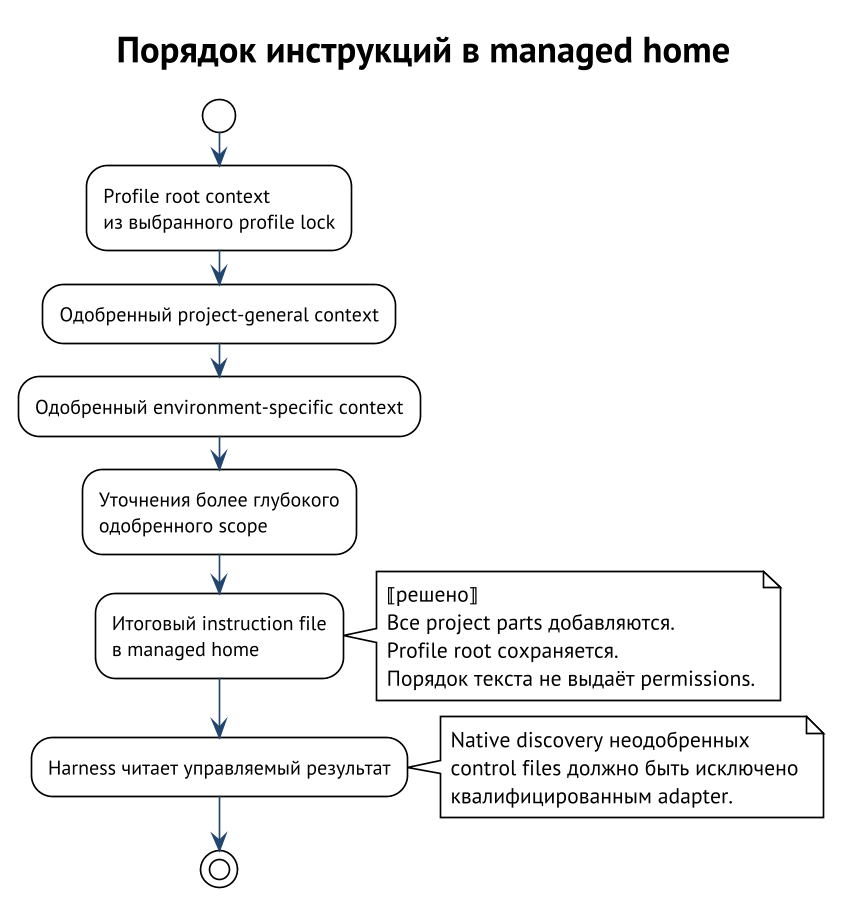

# Слои контекста

У слова «контекст» есть несколько значений. Оно может обозначать исходный
пакет правил, итоговый файл инструкций или всё, что модель увидела за
сессию. Чтобы не подменять одно другим, проследим один конкретный путь:
профиль `review` для проекта `catalog` запускается в Codex.

## Пакет, профиль, home, проект

**Context package** — версионируемая единица исходных инструкций
и требований. Её `agent-context.json` перечисляет модули и зависимости;
сами модули лежат под `context/`. Пакет может требовать другие context
packages, skills и MCP declaration packages. Это исходный материал,
а не домашний каталог готовой сессии. ⟦работает сегодня⟧

**Profile** — установленный выбор корневого context package с разрешённым
замыканием зависимостей и применённой композицией. Имя `review` удобно
для выбора, но точный состав задаёт lock. Несколько profiles могут
использовать один общий пакет, не становясь одним профилем. Пакет без
локальной секции `context` может быть umbrella для зависимостей; отсутствие
этой секции не равнозначно пустому списку модулей. ⟦работает сегодня⟧

**Profile root context** — материализованные корневые инструкции выбранного
профиля для конкретного environment. Curator отбирает применимые модули,
определяет порядок пакетов и строит документ. Это результат вычисления
из lock и правил композиции. Он не выбирается по совпадению имени
`AGENTS.md` в исходном репозитории пакета. ⟦работает сегодня⟧

**Managed home** — отдельный каталог состояния harness, подготовленный
менеджером. Именно в нём находятся доставленные root instructions,
skills и другие управляемые поверхности рядом с состоянием самого
harness. Home не является ещё одним пакетом и не заменяет профиль.
⟦работает сегодня⟧

**Project context** — одобренный вклад конкретного зарегистрированного
checkout поверх выбранного профиля. Он не равен всему checkout и не
приобретается автоматически при открытии каталога. Вклад фиксируется
защищёнными snapshots и отдельными approvals. ⟦решено⟧

**Native sources** — входы, которые harness сам обнаруживает по своим
правилам: home instructions, цепочка файлов проекта, настройки, skills,
plugins и другие поверхности. Они существуют независимо от того,
использован ли Curator. Подмена переменной home сама по себе не выключает
поиск в рабочем дереве. Конкретный набор зависит от harness и версии.

## Порядок добавления инструкций

Проект **никогда не заменяет profile root context**. Одобренный project
context добавляется ниже него в instruction file managed home. Сначала
идёт profile root, затем project-general, затем environment-specific
project context. Более глубокая одобренная область идёт после более
широкой. Это additive composition, а не выбор одного из конкурирующих
root files. ⟦решено⟧

Для `catalog` это означает: базовые правила ревью из `review`, общие
правила устройства каталога, дополнение для Codex, затем одобренные
уточнения для редактируемого подкаталога. Смена harness может изменить
применимость модулей, но не даёт проекту права удалить базовую часть.
Если adapter не воспроизводит требуемую additive composition, запуск
должен быть отклонён. ⟦решено⟧

Порядок текста выражает намерение композиции. Он не превращает поздний
абзац в исполняемую политику и не гарантирует, что LLM разрешит конфликт
правильно. Например, указание проекта «запускай команды без подтверждения»
не выдаёт permissions, даже если стоит последним. Полномочия приходят
через manager policy и grants, с сохранением жёстких запретов. ⟦решено⟧

## Порядок внутри profile root

У базового профиля уже есть собственный механизм порядка. По умолчанию
больший effective weight считается приоритетнее, а приоритетный пакет
располагается позже: `higher-weight` и `winner-last`. Машинная политика
задаёт оба примитива отдельно; нельзя выводить второй только из первого.
При одинаковом весе используется детерминированный порядок зависимостей
с разрешением готовых имён по порядку байтов. Внутри пакета сохраняется
порядок модулей из manifest. ⟦работает сегодня⟧

Допустим, базовый пакет имеет weight `0`, а overlay с правилами Go — `10`.
При стандартной политике сначала печатается базовый пакет, затем overlay.
Если порядок меняется, это часть вычисления профиля и его идентичности,
а не свойство случайного обхода файловой системы. У новых locks политика
precedence хранится явно. ⟦работает сегодня⟧

Модули могут выбирать environments и иметь класс `root` или `system`.
Если класс отсутствует, это `root`. Root-модули образуют обычный instruction
file. System-модули доставляются отдельным каналом adapter и проходят
отдельные правила допуска, особенно для транзитивных зависимостей.
Поднять обычный project text в system prompt, просто назвав файл иначе,
этот механизм не позволяет. ⟦работает сегодня⟧

## Две формы одного результата

В форме `monolithic` Curator собирает полный документ: generation header,
границы пакетов и применимые модули. В `referenced` он материализует
отдельные части и adapter-specific ссылки на них. Поддержка формы зависит
от environment; это не свободная настройка для любого harness. Текст
модулей не проходит шаблонизацию или произвольное выполнение imports:
материализация использует проверенные байты и заданные правила соединения.
⟦работает сегодня⟧

Если корень профиля вообще не объявляет `context`, root surface не
записывается. Если он объявляет `context`, но ни один root-модуль не
применим, возможен документ только с generation header. Это разные
состояния: наличие файла с заголовком не доказывает наличие содержательных
правил, а отсутствие файла не всегда означает поломку. ⟦работает сегодня⟧

Generation header позволяет увидеть корень, members, pins, weights,
precedence и lock hash. Его назначение — объяснить происхождение
сгенерированного документа. Исправление прямо в таком файле создаёт drift;
постоянное изменение надо вносить в источник профиля или его composition.
⟦работает сегодня⟧

## Native discovery — отдельная граница

Представим, что managed `AGENTS.md` построен верно, но harness дополнительно
нашёл в проекте другой файл, требующий вызвать новый сервер. Хэш managed
файла остался правильным. Проверка этого хэша ничего не сказала о втором
источнике.

Поэтому строгий project launch требует двух разных свидетельств: approved
части доставлены точно, unapproved control sources не обнаруживаются
автоматически. Проверка должна покрывать startup, reload, вложенные
каталоги, resume и child-agent entry в пределах заявленной способности
adapter. Native trust флаг на каталог не заменяет такой проверки.
⟦решено⟧

Режим project context `off` в принятой системе означает: остаётся профиль,
а project-native discovery всё равно исключено сертифицированным adapter.
Он не означает «вернуть harness все файлы checkout». Существующее
поведение до enrollment относится к legacy compatibility и не должно
выдаваться за этот строгий режим. ⟦решено⟧

## Что не следует смешивать

| Понятие | Отвечает на вопрос | Чего из него не следует |
| --- | --- | --- |
| Context package | Где объявлены модули и зависимости? | Что пакет уже установлен |
| Profile lock | Какой точный набор выбран? | Что все файлы home исправны |
| Managed home | Где harness хранит своё состояние? | Что процесс изолирован от checkout |
| Project approval | Какой элемент разрешён для этого проекта? | Что разрешён весь каталог |
| Instruction order | Как собран текст? | Что выданы системные полномочия |
| Native trust | Что harness считает доверенным по своим правилам? | Что выполнен per-item manager approval |

Дальше мы разберём, как profile и Skillfile фиксируют выбор, а затем —
как этот выбор превращается в проверяемые файлы home.
