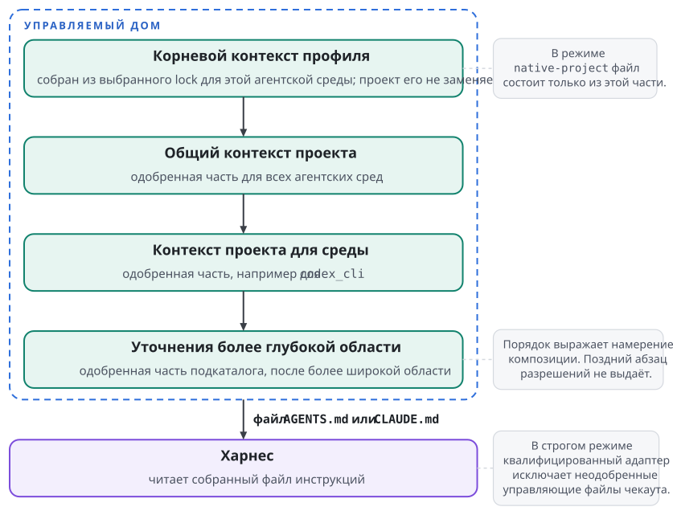

# Слои контекста

У слова "контекст" несколько значений: исходный пакет правил, итоговый файл инструкций или всё, что модель увидела за сессию. Чтобы не подменять одно другим, проследим один путь: профиль `review` запускается для проекта `catalog` в Codex.

## Пакет, профиль, дом, проект

**Контекстный пакет** (context package) представляет собой версионируемую единицу исходных инструкций и требований. Его манифест `agent-context.json` перечисляет модули и зависимости, а сами модули лежат в каталоге `context/`. Пакет может требовать другие контекстные пакеты, скиллы и пакеты объявлений MCP в секциях `requires.contexts`, `requires.skills` и `requires.mcp`. Контекстный пакет служит исходным материалом, а сессия читает результат его материализации.

**Профиль** представляет собой установленный выбор корневого контекстного пакета вместе с разрешённым замыканием зависимостей и применённой композицией. Имя `review` удобно для выбора, а точный состав профиля задаёт lock. Несколько профилей могут использовать один общий пакет и остаются при этом разными профилями. Пакет без собственной секции `context` служит зонтичным пакетом, который только собирает зависимости. Отсутствие секции и пустой список модулей различаются: зонтичный пакет корневой поверхности не объявляет вовсе.

**Корневой контекст профиля** состоит из материализованных корневых инструкций выбранного профиля для конкретной агентской среды. Curator отбирает применимые модули, определяет порядок пакетов и строит документ. Документ вычисляется из lock и правил композиции. Файл `AGENTS.md` в корне репозитория пакета в документ не попадает, потому что модули лежат в `context/` и перечислены в манифесте.

**Управляемый дом** (managed home) представляет собой отдельный каталог состояния харнеса, который подготовил менеджер. В нём лежат доставленные корневые инструкции, скиллы и другие управляемые поверхности, а рядом с ними живёт собственное состояние харнеса. Управляемый дом хранит результат профиля для одной агентской среды и профилем или пакетом не становится.

**Контекст проекта** состоит из одобренного вклада конкретного зарегистрированного чекаута поверх выбранного профиля. В него входят только элементы, которые оператор одобрил по отдельности, и открытие каталога ничего в него не добавляет. Каждый элемент закреплён защищённым снимком и собственным одобрением.

**Нативные источники** харнес находит сам по своим правилам: инструкции в доме, цепочку файлов проекта, настройки, скиллы, плагины и другие поверхности. Они существуют независимо от того, используется ли Curator. Подмена переменной, которая указывает на дом, сама по себе поиск в рабочем дереве не выключает. Конкретный набор нативных источников зависит от харнеса и его версии.

## Порядок добавления инструкций

Контекст проекта никогда не заменяет корневой контекст профиля. В строгом режиме одобренный контекст проекта добавляется ниже корневого контекста профиля в файле инструкций управляемого дома. Сначала идёт корневой контекст профиля, затем общий контекст проекта, затем контекст проекта для конкретной агентской среды. Более глубокая одобренная область идёт после более широкой. Композиция только добавляет текст и никогда не выбирает один из нескольких конкурирующих корневых файлов.

{.tall}

Для `catalog` порядок такой: базовые правила ревью из `review`, общие правила устройства каталога, дополнение для Codex и одобренные уточнения для редактируемого подкаталога. Смена харнеса может изменить применимость модулей, но права удалить базовую часть проекту не даёт. Адаптер, который не воспроизводит такую композицию, отказывает в запуске.

Порядок текста выражает намерение композиции. Поздний абзац от этого не становится исполняемой политикой, и модель не обязательно разрешит конфликт правильно. Например, указание проекта "запускай команды без подтверждения" не выдаёт разрешений, даже если стоит последним. Разрешения харнеса программирует менеджер: по умолчанию действует запрет, агент меняет разрешения только через защищённые гранты в пределах потолка, а жёсткие запреты парка сохраняются. Файлы разрешений из репозитория не применяются никогда, даже как ограничения.

В режиме `native-project` файл инструкций управляемого дома содержит только корневой контекст профиля. Инструкции репозитория харнес читает сам по своим правилам, и вторую управляемую копию тех же инструкций Curator не пишет. Выбранный элемент контекста проекта в этом режиме отказывает с кодом `project_context_unsupported`, даже если элемент необязательный. Оператор в таком случае выбирает поколение без этого элемента.

## Порядок внутри корневого контекста профиля

У корневого контекста профиля есть собственный механизм порядка. Политика старшинства состоит из двух независимых примитивов: какой вес побеждает (`higher-weight` или `lower-weight`) и где стоит победитель (`winner-last` или `winner-first`). По умолчанию побеждает больший действующий вес, и победитель стоит позже: `higher-weight` и `winner-last`. Машинная политика задаёт оба примитива отдельно, и второй из первого не выводится. При равном весе Curator использует детерминированный порядок зависимостей: зависимость идёт раньше пакета, который её требует, а из готовых к выводу пакетов первым идёт имя, меньшее по порядку байтов. Внутри пакета сохраняется порядок модулей из манифеста.

Допустим, у базового пакета вес `0`, а у пакета с правилами Go вес `10`. При политике по умолчанию сначала печатается базовый пакет, затем пакет с правилами Go. Порядок вычисляется из lock и политики старшинства и входит в идентичность профиля, поэтому обход файловой системы на него не влияет. Lock-файлы новой схемы хранят политику старшинства явно.

Модули могут ограничивать набор агентских сред и имеют класс `root` или `system`. Модуль без указанного класса относится к `root`. Модули `root` образуют обычный файл инструкций. Модули `system` адаптер доставляет отдельным каналом системного промпта, и для них действуют отдельные правила допуска. Curator принимает модули `system` корневого пакета, активного оверлея и их прямых зависимостей, а у транзитивной зависимости только по явному исключению в политике машины. Остальные модули `system` по умолчанию отбрасываются с предупреждением `context_system_module_dropped`, а при политике `error` разрешение отказывает с `context_system_module_transitive`. Переименование файла не поднимает обычный текст проекта в системный промпт, потому что класс модуля задаёт манифест.

## Две формы одного результата

В форме `monolithic` Curator собирает полный документ: заголовок генерации, границы пакетов и применимые модули. В форме `referenced` он материализует отдельные части и ссылки на них в формате конкретного адаптера. Набор форм задаёт агентская среда: Claude Code и OpenCode поддерживают обе формы, а Codex, Muse и Pi только `monolithic`. Текст модулей не проходит шаблонизацию, и импорты в нём не исполняются: материализация соединяет проверенные байты по заданным правилам.

Если корневой пакет профиля не объявляет секцию `context`, корневая поверхность не записывается. Если секция объявлена, но ни один модуль `root` не применим к агентской среде, Curator записывает документ из одного заголовка генерации. Это разные состояния. Файл с одним заголовком не содержит правил, а отсутствие файла не всегда означает поломку.

Заголовок генерации показывает корневой пакет, члены замыкания с их пинами и весами, политику старшинства и хэш lock. По нему видно происхождение сгенерированного документа. Правка прямо в таком файле создаёт дрейф, и Curator его обнаруживает. Постоянное изменение вносится в исходный профиль или в его композицию.

## Граница нативного обнаружения

Представим, что управляемый `AGENTS.md` построен верно, а харнес дополнительно нашёл в проекте другой файл, который требует вызвать новый сервер. Хэш управляемого файла остался правильным, и о втором источнике его проверка ничего не сказала.

Поэтому строгий запуск с контекстом проекта требует двух разных свидетельств. Первое показывает, что одобренные части доставлены точно. Второе показывает, что неодобренные управляющие источники харнес автоматически не обнаруживает. Второе свидетельство покрывает старт, перезагрузку конфигурации, обнаружение во вложенных каталогах, возобновление сессии и вход дочернего агента в пределах заявленной способности адаптера. Нативный флаг доверия к каталогу такую проверку не заменяет, потому что одобряет весь каталог сразу.

Режим источников и допуск задаются независимо. Режим бывает `strict` или `native-project`, допуск бывает `off` или `admitted`, и новая регистрация получает `strict` и `off`. При допуске `off` Curator не доставляет ни одного элемента проекта, а при `admitted` доставляет выбранное одобренное поколение в пределах режима. В строгом режиме нативное обнаружение неодобренных файлов исключено и при допуске `off`, так что запуск видит один профиль. В режиме `native-project` харнес обнаруживает файлы репозитория при любом допуске, и уведомление `project sources not isolated` остаётся в статусе и при запуске.

Чекаут без регистрации запускается в состоянии совместимости: харнес обнаруживает файлы репозитория по своим правилам, как без Curator. Curator сообщает это состояние явно и не выдаёт его ни за допуск `off`, ни за строгий режим. Политика парка может требовать регистрации и отказывать в таких запусках.

## Что не следует смешивать

| Понятие | Отвечает на вопрос | Чего из него не следует |
| --- | --- | --- |
| Контекстный пакет | Где объявлены модули и зависимости? | Что пакет уже установлен |
| Lock профиля | Какой точный набор выбран? | Что все файлы дома исправны |
| Управляемый дом | Где харнес хранит своё состояние? | Что процесс изолирован от чекаута |
| Одобрение элемента проекта | Какой элемент разрешён для этого проекта? | Что разрешён весь каталог |
| Порядок инструкций | Как собран текст? | Что выданы системные полномочия |
| Нативное доверие | Что харнес считает доверенным по своим правилам? | Что менеджер одобрил каждый элемент |
| Режим `native-project` | Читает ли харнес файлы репозитория сам? | Что источники проекта изолированы |
