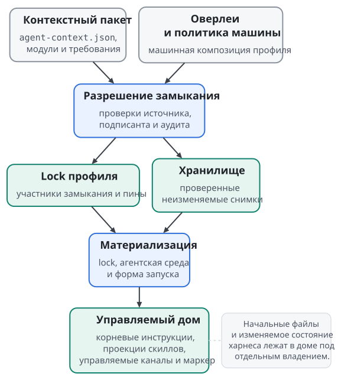

# Профили и воспроизводимые источники

Профиль собирает повторяемую часть окружения агента: общие инструкции, скиллы и объявления MCP-серверов. На профиль опирается режим работы, которым пользуются несколько проектов, например `review` или `development`. Особенности конкретного проекта живут в отдельном слое (глава "Контекст проекта и рабочее место"), поэтому общий профиль ради них не переписывают.

## Манифест контекстного пакета

Контекстным пакетом называется каталог или git-репозиторий с манифестом `agent-context.json` в корне. Манифест называет имя и версию пакета, перечисляет модули контекста и требования к другим пакетам. Минимальный пакет общих правил объявляется так:

```json
{
  "schema_version": 1,
  "name": "review-base",
  "version": "1.0.0",
  "context": {
    "modules": [
      {"path": "00-general.md"},
      {"path": "10-codex.md", "environments": ["codex_cli"]}
    ]
  }
}
```

Модули лежат в каталоге `context/` пакета, так что первый путь обозначает `context/00-general.md`, а второй `context/10-codex.md`. Модуль без поля `environments` применяется во всех агентских средах, второй модуль попадает только в `codex_cli`. Необязательное поле `class` относит модуль к корневому контексту (`root`, значение по умолчанию) или к системному промпту (`system`); порядок и доставку обоих классов описывает глава "Слои контекста".

Менеджер проверяет каждый объявленный модуль до того, как его использовать. Путь модуля обязан быть переносимым относительным путём: абсолютный путь, компонент `..` и обратная косая черта отклоняются при разборе манифеста. Сам модуль должен быть обычным файлом, поэтому symlink на файл из соседнего каталога проверку не проходит. Содержимое модуля представляет собой Markdown в UTF-8 с концами строк LF и ровно одним завершающим LF. Отсутствующий модуль даёт `profile_module_missing`, неверные байты дают `profile_module_bytes_invalid`.

Раздел `requires` объявляет зависимости трёх видов: `contexts`, `skills` и `mcp`. Контекстный пакет добавляет модули, скилл приносит агенту свой контекст и команды, пакет MCP объявляет конфигурацию сервера в файле `agent-mcp.json`. Все три вида разрешаются в одном графе зависимостей. Вид требования определяет, что пакет даёт окружению, и один вид другой не заменяет.

Каждое git-требование называет репозиторий полем `git` и ровно одну форму выбора: диапазон `range` по тегам, точный тег `tag` или полную ревизию `revision`. Менеджер ищет выбор, совместимый со всеми пакетами, которые требуют одно имя. Несовместимые требования к одному имени останавливают разрешение: две версии одного пакета под одним именем в замыкание не попадают.

Схема манифеста 2 позволяет требованию скилла выбрать каталог внутри репозитория полем `directory`. Выбранный каталог входит в идентичность скилла. Все пакеты, которые требуют один скилл, обязаны назвать один канонический источник и один каталог, причём отсутствие `directory` означает корень репозитория. Расхождение даёт `context_range_conflict` с источником и каталогом каждого требующего пакета. Схема 1 отклоняет `directory` у скилла как `context_manifest_invalid`, а требования контекстов и MCP принимают это поле в обеих схемах.

## Профиль и Skillfile

Профиль и `Skillfile.json` пользуются декларациями и закреплённым выбором, но у них разные схемы, разные lock-файлы и разные области действия. Профиль начинается с корневого контекстного пакета и хранит своё замыкание в lock профиля в каталоге менеджера. `Skillfile.json` описывает скиллы одного проекта, и его lock лежит в репозитории проекта. Копия `Skillfile.json` в доме агента профиля не создаёт.

Чтобы установить профиль из git с точным тегом, передайте `curator profile install` адрес и тег:

```sh
curator profile install https://example.org/review-base.git --tag v1.0.0 --as review
```

Менеджер разрешает замыкание корневого пакета, проверяет его и публикует lock профиля `review`. Вместо тега принимаются `--range` и `--revision`, флаг `--directory` выбирает пакет внутри репозитория, а локальный каталог тоже годится в качестве источника. Без флага `--use` профиль остаётся установленным и неактивным, и `curator profile use review` делает его текущим позже.

Проектный `Skillfile.json` схемы 2 вводит именованные источники и выбор пакетов внутри них. Путь в примере относителен каталогу самого `Skillfile.json`:

```json
{
  "schema_version": 2,
  "sources": {
    "local": {"path": "./packages"}
  },
  "skills": [
    {"name": "review", "from": "local", "directory": "review"}
  ]
}
```

Источник с полем `path` закрепляет текущие байты выбранного каталога, включая изменённые, проиндексированные и неотслеживаемые файлы. Состояние `HEAD` в git для такого источника ничего не значит. Источник из git закрепляет ровно один тег, ветку или ревизию, причём ветка допустима только в корневом проекте. Коллекция с полями `include` и `exclude` выбирает сразу несколько дочерних каталогов одного источника. Эти формы принадлежат `Skillfile.json`, и в требования контекстного манифеста их не переносят. Машинный `Skillfile.json` для глобальных скиллов остаётся на схеме 1.

Жизненный цикл проекта задают четыре команды:

```sh
curator project resolve .
curator install .
curator status .
curator project refresh .
```

`resolve` закрепляет источники в `Skillfile.lock.json`, `install` ставит закреплённый снимок, `status` сравнивает установку с ожидаемым состоянием, а `refresh` явно разрешает источники заново. `Skillfile.lock.json` коммитят вместе с `Skillfile.json`, как `package-lock.json`. Если `Skillfile.json` изменили после `resolve`, установка отказывает с `source_lock_stale` до явного `refresh`. Сам `refresh` живую установку не меняет: новый lock применяет следующий `install`. Запуск и `status` никогда не разрешают источники заново и не двигают ветку.

## Зачем нужен lock

Номер версии сообщает намерение автора пакета. Lock-файл фиксирует точный выбор менеджера: участников замыкания, идентичность их источников, пины и данные композиции, то есть веса и оверлеи. Хэш lock профиля в форме `sha256:<64 hex>` служит пином профиля везде, где что-то привязано к профилю. Два профиля с одинаковым человеческим именем и разными lock-файлами считаются разными окружениями.

Лаунчер `curator-run` пользуется этим пином. Запись рабочего места может закрепить нужный хэш lock профиля полем `profile_lock_sha256`. Если профиль, разрешённый при подъёме рабочего места, дал другой lock, `curator-run werkstatt up` отказывает с `werkstatt_profile_lock_mismatch` до хуков, запуска и возобновления сессии.

{.tall}

Lock не заменяет байты в хранилище. Если закреплённый снимок проекта пропал, `curator install` восстанавливает его из объявленного источника. Для git-источника менеджер забирает закреплённую ревизию, поэтому перемещённый тег не превращает восстановление в обновление. Для источника `path` он перечитывает байты каталога. В обоих случаях восстановление продолжается, только если идентичность пакета и `content_sha256` совпадают с lock, а байты lock-файла остаются прежними.

Установка и обновление профиля разрешают зависимости и проверяют кандидата до публикации. Если проверка кандидата не прошла, команда завершается ошибкой и действующий lock остаётся нетронутым. Конфликт поверхностей адаптера при активации разбирается отдельно: новый lock может остаться опубликованным, конфликтующие поверхности сохраняют прежнее состояние, и менеджер сообщает о расхождении. Успешное обновление сохраняет прежний lock рядом с новым до сборки мусора, чтобы к нему можно было вернуться. Переходы между состояниями выполняются под блокировкой менеджера и через журнал, который восстанавливает согласованное состояние после прерывания.

## Оверлеи и общие правила

Оверлеем называется дополнительный контекстный пакет, который машинная конфигурация добавляет к профилю. Оверлеи профиля перечислены в `overlays.<профиль>` и задаются командой `curator profile compose <профиль> add` с git-источником и одной формой выбора или с локальным каталогом. Оверлей входит в замыкание рядом с корневым пакетом и разрешается вместе с ним, а его вес задаёт оператор или значение `overlay_default_weight`. Оверлей с именем, которое уже есть в замыкании, отклоняется как `environment_composition_invalid`. Политика, которая запрещает композицию, отключает все оверлеи, и тогда корневой пакет разрешается один.

Оверлей удобен для общих правил платформы или языка: профиль получает их при каждом запуске в подходящей среде. Оверлей профиля не одобряет проект и не задаёт идентичность чекаута, этим занимается контекст проекта.

Пример. Общий пакет `review` требует проверять каждое изменение поведения, а оверлей Go объясняет команды проверки для этого языка. Оба собираются в один корневой контекст профиля по правилам главы "Слои контекста". Документация конкретного сервиса относится к контексту проекта, иначе она попала бы во все проекты, которые пользуются профилем `review`.

## Аудит и полномочия

Аудит проверяет приобретённое содержимое до публикации, причём замыкание профиля проверяется целиком до того, как хоть один пакет попадёт в хранилище. Белый список источников, политика подписантов, политика реестра и отдельный белый список MCP задают разные ограничения. Машинная конфигурация схемы 2 по умолчанию выбирает позицию безопасности `hardened`. В ней аудит и политика реестра строгие, транзитивные системные модули без машинного исключения отклоняются, а источники обязаны быть подписаны. Пустой белый список источников останавливает установку и обновление, а пустой белый список MCP останавливает композицию профиля, в котором есть объявления MCP.

Подпись отвечает, каким ключом подписан источник. Хэш содержимого отвечает, какие байты выбраны. Аудит выносит вердикт в пределах своих детекторов и политики. Ни один из этих механизмов по отдельности не доказывает, что пакет уместен для любой задачи. Доверенный источник выбирает оператор, и инструкция внутри пакета не меняет машинную политику оттого, что пакет прошёл проверку.

## MCP в профиле и в Skillfile

Профиль объявляет MCP-серверы требованиями `requires.mcp` к пакетам с `agent-mcp.json`. Менеджер материализует такое объявление в канал MCP управляемого дома. Материализация не запускает процесс сервера и не проверяет вход к нему. Проверка требований к MCP только читает конфигурацию и права на запись нативных файлов не даёт.

Проектный `Skillfile.json` объявляет серверы в поле `mcp_servers` схемы 3, которая наследует схему 2. Объявление ссылается на git-пакет с точным выбором версии. `curator project resolve` проверяет каждый такой пакет по машинным белым спискам источников и MCP, политике подписантов, отзывам, строгому аудиту и машинному потолку имён переменных окружения. Затем он публикует `Skillfile.mcp-lock.json` рядом с прежним lock источников. Lock, пришедший из репозитория, сам установку не разрешает: менеджер хранит отдельное локальное право на воспроизведение вне проекта.

Объявление сервера прямо в `Skillfile.json`, адресом или объектом, требует отдельного одобрения. Одобрение связывает зарегистрированный проект, имя сервера и дайджест нормализованного объекта сервера. Новый адрес, другие аргументы, имена переменных или набор сред требуют нового одобрения. Запись, которая отличается только синтаксисом и после нормализации даёт тот же сервер, связь не меняет. Записи одобрений хранятся вне репозитория, и одобрение из репозитория не принимается.

Поле `mcp_servers` существует только в схеме 3. Файл схемы 2 с этим полем отклоняется как содержащий неподдерживаемое поле, и ни одна команда не поднимает схему манифеста неявно. Грамматику объявлений, параметры установки и отчёт по каждой паре сервера и среды описывает глава "MCP: от зависимости до нативной конфигурации". Для модели профиля достаточно одного правила: декларация запрашивает инструмент, а право его включить проверяется отдельно и в репозитории проекта не хранится.

## Команды скиллов профиля

Скилл приносит агенту контекст и команды, которые агент вызывает из `PATH`. Профиль ставит команды своих скиллов тем же обычным установщиком скиллов, что и `Skillfile.json`. Поэтому у команд профиля те же аудит, допуск источников, доверенные драйверы сборки, защищённый кэш сборки и проверка квитанций сборки, что и у глобальных команд.

Требование скилла в профиле задаёт режим полем `mode`:

| Режим | Контекст скилла | Команды |
| --- | --- | --- |
| `full`, по умолчанию | доставляется | все экспортированные команды |
| `context` | доставляется | по этому требованию ни одной |
| `runtime` | по этому требованию не доставляется | все или непустой список `commands` |

Режимы нескольких требований к одному скиллу складываются. Требование `context` и суженное требование `runtime` вместе дают контекст и выбранные команды, а отдельное требование `full` включает все команды. Сужение ограничивает только своё требование и не отменяет чужого. Каждое имя в `commands` менеджер сверяет со списком экспортированных команд скилла, и неизвестное имя отклоняется.

Lock профиля хранит план скиллов целиком: каждого участника с источником, ревизией, выбранным каталогом и идентичностью содержимого, каждое ребро от потребителя к поставщику с режимом и выбором команд. Без такого плана повторная сборка после восстановления потеряла бы сужение, а скилл в режиме `runtime` подмешал бы свой контекст в инструкции. Lock прежнего формата Curator читает для осмотра и для доставки контекста. Чтобы получить команды, профиль обновляют явно командой `curator profile update` или ставят заново. Команды `use`, `sync`, `status` и восстановление никогда не переводят lock в новый формат разрешением свежих ссылок.

Установка готовит сборку команд до публикации lock. Неудачная сборка оставляет прежний профиль рабочим: lock, указатель текущего профиля, контекст и шимы не меняются. Команда с именем `curator-*` отклоняется как `environment_reserved_command_name`, а чужой файл на месте шима менеджер не перезаписывает. Установка команды не даёт скиллу личности и полномочий: если скилл требует отдельной регистрации экземпляра, эта регистрация остаётся контрактом самого скилла.

Команды доходят до запуска в два шага. На первом шаге канонические шимы текущего профиля машины лежат в `<каталог-менеджера>/global/bin`, а каталог пользователя содержит пересылающие шимы к ним. Неактивные профили хранят собранные поколения команд без публикации в оболочку. Запуск другого профиля в его управляемом доме команд этого профиля из машинных шимов не получает, и случайно унаследованный машинный шим такое требование не удовлетворяет. Поэтому первый шаг подходит машине или изолированной среде, где все потребители команд работают с одним текущим профилем.

На втором шаге каждый профиль получает собственный неизменяемый корень команд, привязанный к его lock:

```text
<каталог-менеджера>/environments/<профиль>/commands/<хэш-lock>/<платформа>/bin
```

Корень содержит ровно шимы активных команд этого lock, а его маркер связывает lock, идентичности источников, квитанции сборки и исполняемые цели. Проверенный fragment добавляет этот корень в начало `PATH` полем `path_prepend`. Лаунчер сверяет пин профиля, маркер, владельца, режим доступа и границы путей до того, как изменить `PATH`, и передаёт процессу одно вычисленное значение. Если команды профиля обязательны, а корень отсутствует или не прошёл проверку, запуск отказывает, и машинные шимы молча его не заменяют. Работающая сессия сохраняет своё разрешение команд при обновлении профиля, поэтому два установленных профиля могут одновременно работать с разными версиями одной команды. Снимок сессии, аренда запуска, слот отката и незавершённая транзакция держат поколение команд живым, и сборка мусора удаляет его только после того, как исчезнут все такие ссылки.
