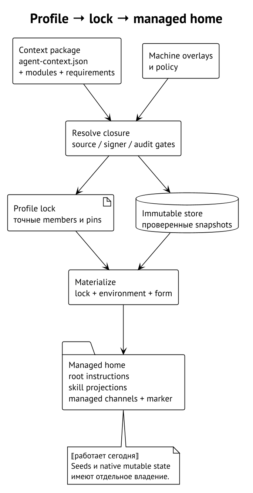

# Профили и воспроизводимые источники

Profile объединяет повторяемую часть окружения: общие инструкции,
skills и MCP declarations. Это удобный уровень для режима работы
`review` или `development`, которым пользуются несколько проектов.
Проектные особенности не требуют переписывать общий профиль: для них
предназначен отдельный слой из следующей части книги.

## Что объявляет context manifest

В корне context package находится `agent-context.json`. В нём есть имя,
версия, список локальных модулей и требования к другим пакетам. Например,
минимальный пакет общих правил можно объявить так. Здесь используются
поддерживаемые поля manifest schema 1. ⟦работает сегодня⟧

```json
{
  "schema_version": 1,
  "name": "review-base",
  "version": "1.0.0",
  "context": {
    "modules": [
      {"path": "00-general.md"},
      {"path": "10-codex.md", "environments": ["codex_cli"]}
    ]
  }
}
```

Первый путь обозначает `context/00-general.md`, второй —
`context/10-codex.md`. Первый модуль применяется ко всем environments,
второй — к Codex. Reader проверяет объявленные файлы и допустимые пути;
нельзя получить модуль из произвольного соседнего каталога через `..`
или symlink. Содержимое модулей — UTF-8 Markdown с LF endings и ровно
одним завершающим LF. ⟦работает сегодня⟧

Требования `requires.contexts`, `requires.skills` и `requires.mcp`
показывают три разных вида зависимости. Context package добавляет
модули; skill приносит агентский контекст и, при соответствующем
описании, команды; MCP package объявляет server configuration. Общий
dependency graph не делает эти виды взаимозаменяемыми. ⟦работает сегодня⟧

Для Git requirements выбирается одна форма: range, tag или revision.
Resolver находит совместимый выбор; конфликт требований не означает
«поставить две случайные версии под одним именем». Schema 2 дополнительно
позволяет skill requirement выбрать `directory` внутри репозитория.
Выбор каталога входит в идентичность и должен совпадать у requirers
одного skill. Schema 1 такой selector не принимает. ⟦работает сегодня⟧

## Profile и Skillfile — разные декларации

Profile начинает от context package и сохраняет своё замыкание в profile
lock. `Skillfile.json` описывает skill dependencies проекта. Оба пути
используют декларации и зафиксированный выбор, но у них разные schemas,
locks и области действия. Копирование Skillfile в home не создаёт профиль.
⟦работает сегодня⟧

Проектный Skillfile schema 2 вводит именованные sources и выбор пакетов
внутри них. Пример использует относительный путь самого проекта,
а не путь чьей-либо машины. ⟦работает сегодня⟧

```json
{
  "schema_version": 2,
  "sources": {
    "local": {"path": "./packages"}
  },
  "skills": [
    {"name": "review", "from": "local", "directory": "review"}
  ]
}
```

Здесь Curator фиксирует текущие bytes working tree выбранного source,
а не предполагает, что они равны Git HEAD. Git source вместо path выбирает
точный tag, branch или revision по правилам source extension. Эти формы
Skillfile не надо переносить в context requirements: похожие слова
не означают одинаковую grammar. ⟦работает сегодня⟧

```sh
curator project resolve .
curator install .
curator status .
curator project refresh .
```

`resolve` фиксирует sources в `Skillfile.lock.json`, `install` использует
locked snapshot, `status` сравнивает установку с ожидаемым состоянием,
а `refresh` явно разрешает sources заново. При несовпадении manifest
и lock операция требует согласованного обновления; обычное потребление
lock не является разрешением незаметно выбрать новые входы.
⟦работает сегодня⟧

## Зачем нужен lock

Название версии сообщает намерение автора пакета. Lock сообщает точный
выбор менеджера: members замыкания, source identity, pins и данные
композиции. Для profile его hash является effective pin. Поэтому два
профиля с одинаковым человеческим именем, но разными locks не считаются
одним и тем же окружением. ⟦работает сегодня⟧



Lock не заменяет байты store. Если locked project snapshot утрачен,
Curator может восстановить его из объявленного source и сверить identity
и content hash. Для Git replay используется locked commit; перемещённый
tag не должен превратить восстановление в обновление. Для path source
изменившиеся bytes не принимаются под старой идентичностью.
⟦работает сегодня⟧

Profile install и update разрешают зависимости и проверяют кандидата
до публикации. Важная граница — отказ обновления не должен превращать
candidate в новый действующий lock. Предыдущий lock сохраняется для
жизненного цикла обновления, а переходы выполняются под mutation lock
и через recoverable publication. ⟦работает сегодня⟧

## Overlays и общие правила

Overlay — дополнительный context package, включённый машинной
композицией профиля. Он участвует в общем замыкании и порядке weights.
Это удобно для общих правил платформы или языка: один profile получает
их при каждом соответствующем запуске. Overlay профиля не является
project approval и не задаёт отдельную идентичность checkout.
⟦работает сегодня⟧

Например, общий пакет review задаёт обязательную проверку изменения
поведения, а overlay Go объясняет команды проверок языка. Они собираются
в один profile root по правилам главы «Слои контекста». Документация
конкретного сервиса относится к project context: она не должна оказаться
во всех проектах, использующих профиль `review`. ⟦решено⟧

## Audit и authority

Audit проверяет приобретённое содержимое до публикации. Source allowlists,
signer policy, registry policy и отдельная MCP allowlist задают разные
ограничения. Hardened posture усиливает defaults: в частности, пустые
allowlists нельзя считать молчаливым разрешением любого источника.
Конкретные отказы зависят от вида операции и эффективной машинной политики.
⟦работает сегодня⟧

Подпись отвечает, каким ключом подписан источник. Content hash отвечает,
какие bytes выбраны. Audit выдаёт verdict в рамках своих detectors
и policy. Ни один из этих механизмов по отдельности не доказывает,
что пакет уместен для любой задачи. Выбор доверенного источника остаётся
решением оператора, а инструкция внутри пакета не вправе менять machine
policy только потому, что пакет успешно прошёл проверку.

## Где здесь MCP из Skillfile

Действующий профиль уже может требовать MCP declaration packages
с `agent-mcp.json`. Материализация такого объявления не равна запуску
server process или проверке login. Read-only requirement checks также
не означают разрешение произвольной native write-management операции.
⟦работает сегодня⟧

Принято расширение project Skillfile для `mcp_servers`: сначала
Git declaration packages, затем inline server declarations с отдельным
одобрением. Inline approval связывает зарегистрированный проект, имя
server и digest нормализованного server object. Изменение endpoint,
аргументов, env names или набора environments требует нового approval;
синтаксически другая запись того же нормализованного server не обязана
менять эту связь. ⟦решено⟧

Это следующий формат, а не допустимое поле существующего schema 2.
Текущий reader принимает Skillfile schemas 1 и 2 и отклоняет неподдерживаемую
версию. Нельзя просто дописать `mcp_servers` в старый файл и рассчитывать,
что игнорирование незнакомого поля обеспечит совместимость.
⟦работает сегодня⟧

Подробная grammar MCP, writer-local install options и отчёт по каждой
паре server/environment относятся к отдельной главе. Для текущей модели
важно одно: декларация запрашивает инструмент, а authority его активировать
проверяется отдельно и не хранится в репозитории проекта. ⟦решено⟧
