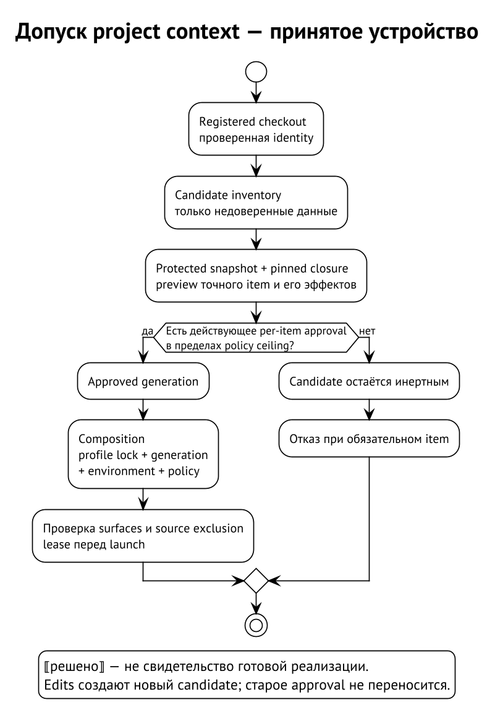
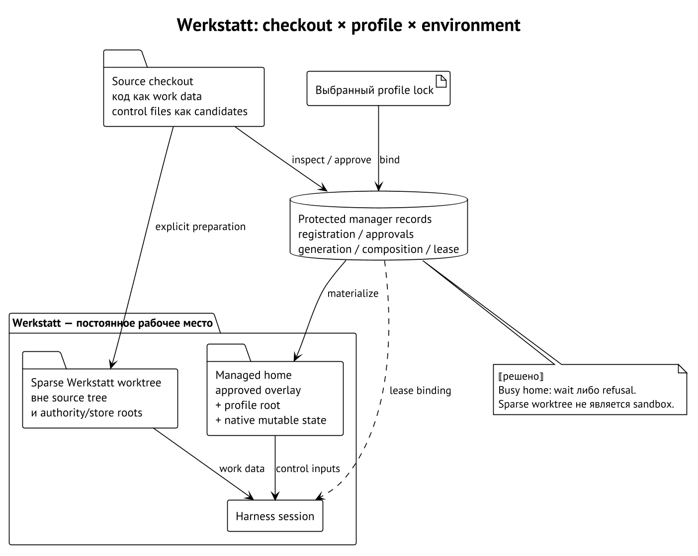
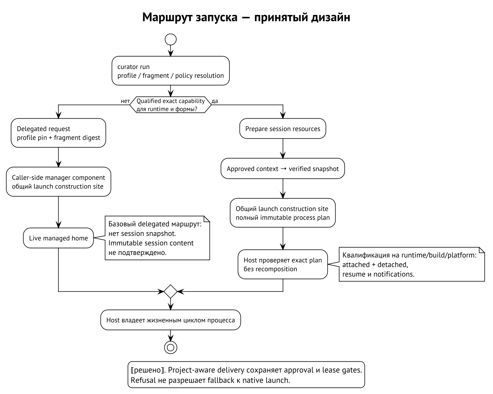

# Project context и Werkstatt

Профиль полезен именно тем, что повторяется между проектами. Но проекту
нужны свои правила: где границы модулей, как устроена схема данных,
какой skill нужен для проверки и к какому MCP endpoint можно обратиться.
Project context добавляет такие сведения к выбранному профилю, сохраняя
отдельную границу их допуска.

Далее описан принятый дизайн. Он требует versioned carriers, реализации
и квалификации adapters; перечисленные операции объясняют модель,
а не обещают доступность соответствующих CLI flags в текущем релизе.
⟦решено⟧

## Registration задаёт идентичность checkout

Registration — защищённая manager record, связывающая project identity
с конкретным checkout, выбранным profile и environment. Читаемое имя
удобно для оператора; authority исходит из записи менеджера и проверенной
идентичности корня. Репозиторий не может назначить себе регистрацию
файлом внутри `.git` или полем собственного manifest. ⟦решено⟧

Например, два checkout проекта `catalog` могут содержать одинаковые
commits. Это не даёт второму права использовать approvals первого.
Замена дерева по старому пути тоже не сохраняет authority автоматически:
проверяется repository binding и filesystem identity. При переносе или
неоднозначности нужен явный rebind, а не угадывание по имени каталога.
⟦решено⟧

Регистрация сама по себе ничего не одобряет. Новый проект начинает
с выключенного project contribution; строгий запуск всё равно требует
исключить неодобренные native sources. Это защищает смысл операции:
«я знаю, где проект» не равно «все настройки проекта разрешены».
⟦решено⟧

## Candidate — материал для решения

Candidate item — обнаруженный или явно предложенный элемент управляющего
контекста. Discovery читает его как недоверенные данные, не выполняет
hooks, не подключает MCP server, не делает package install и не исполняет
shell initialization. Preview показывает будущий эффект, но не даёт
элементу authority. ⟦решено⟧

Широкая модель допускает категории context, rules, knowledge, skills,
commands, MCP и ограниченные native settings. Первая ограниченная поставка
сужает vocabulary до context-package items, whole skills и inline MCP.
Rules dialects, hooks, plugins, произвольные native settings и private-memory
delivery не становятся доступными от одного включённого category switch.
⟦решено⟧

Для context item первой поставки нужен явный `agent-context.json`
с `context.modules`, retained lock и полным pinned closure context packages.
Одиночный `AGENTS.md` не превращается в item по имени файла. Если оператор
хочет принять такие bytes, он явно упаковывает их и затем рассматривает
полученный candidate. Менеджер не выбирает за него неутверждённый entry.
⟦решено⟧

В этом сужении context closure содержит context members: оно не может
попутно активировать `requires.skills`, `requires.mcp` или непустые native
settings. Skills и MCP проходят как отдельные items со своими approvals.
Даже inventoried native import не даёт harness права автоматически читать
новые control files; поддержка import dialect потребует отдельного
контракта. ⟦решено⟧

## Одобрение относится к каждому элементу

Approval фиксирует точный item, checkout, environment, approver и policy
ceiling. Включение категории разрешает рассматривать её элементы,
но не одобряет их все разом. Агент может approve только в пределах
заранее выданного защищённого grant; ни человек, ни агент не могут
обойти immutable fleet или manager denies. ⟦решено⟧

Допустим, оператор одобрил package с двумя context modules. Автор проекта
переставил entries в `context.modules`, сохранив те же файлы. Изменился
выбор порядка и digest item; прежнее approval не покрывает такой candidate.
Если же кто-то изменил protected stored bytes под старым digest,
это drift, а не новый автоматически допустимый baseline. ⟦решено⟧

Для inline MCP approval связывает project identity, server name
и digest нормализованного `server` object. Новый endpoint, другой порядок
arguments или добавленное env name требуют нового решения. Простая
HTTPS URL тоже является управляющим вкладом и не одобряется неявно.
Переименование server или перенос декларации в другой проект не
позволяют воспроизвести старое approval. ⟦решено⟧

Нормализация не означает «сделать похожим». Она раскрывает shorthand,
упорядочивает set-like selectors и object keys, но сохраняет скалярные
значения и порядок command arguments. Server digest, declaration digest
и raw manifest identity решают разные задачи; один не подменяет другой.
Конкретная grammar относится к расширению Skillfile. ⟦решено⟧

## Generation и composition

Approved generation — упорядоченный набор допущенных items. Edits checkout
создают кандидатов для следующей generation; действующая не следует за
ними автоматически. Preview должен показать не только изменённый текст,
но и dependency changes, command owners, MCP transports/endpoints
и эффект permissions. ⟦решено⟧

Composition связывает generation с **lock выбранного профиля**, environment,
adapter и эффективной policy. Это отдельная производная запись. Она не
становится новым profile lock и не изменяет профиль, которым продолжают
пользоваться другие проекты. ⟦решено⟧

Root instructions соединяются в порядке главы «Слои контекста»: profile
root, project-general, environment-specific, затем более глубокий approved
scope. Whole-skill replacement имеет другой контракт: он относится
ко всему skill одной identity, включая команды и providers, с повторной
проверкой requirements. В первой поставке нельзя выводить разрешение
такого replacement из одной additive context approval. ⟦решено⟧

MCP с одинаковым stable ID и digest может deduplicate. Иной server
с тем же ID требует explicit replacement approval. Для commands нужен
единственный owner; две разные skills не могут молча выиграть один
command name случайным порядком файлов. Required item нельзя потерять
под видом optional omission; неподдерживаемая обязательная способность
блокирует launch. ⟦решено⟧

## Werkstatt — постоянное рабочее место

Werkstatt — persistent manager-owned home для checkout × profile ×
environment. Он соединяет базовый профиль, approved project overlay
и native mutable state конкретного рабочего места. Home живёт дольше
отдельной generation: после idle update можно сохранить login и session
state, не создавая новый home для каждого digest. ⟦решено⟧

Принята repository overlay в Werkstatt home и sparse Werkstatt worktree
вне исходного repository tree и authority/store roots. Composition
связывает source checkout identity, sparse selection и worktree identity.
Это подготовленная рабочая поверхность для harness; сам sparse checkout
не доказывает исключение всех native sources и не является sandbox
против hostile code. ⟦решено⟧

Например, два проекта с профилем `review` получают разные Werkstätten.
А `review` и `development` одного checkout также не обязаны разделять
native state. Это и есть новая размерность по сравнению с действующей
парой profile × environment. Перенос approvals или native state между
такими местами требует собственного основания. ⟦решено⟧

## Lease удерживает управляющее состояние

Lease связывает composition с конкретной session identity и generation.
Пока home используется, repair, profile switch, skill sync или замена
composition должны ждать освобождения либо отказать. Нельзя заменить
generated instructions под работающей сессией и считать прежний launch
digest доказательством нового состояния. ⟦решено⟧

Detach не освобождает lease. Resume использует записанную composition,
а не сегодняшнюю active generation. PID и истёкший timeout по отдельности
не доказывают завершение; unknown liveness сохраняет lease. Garbage
collection не удаляет используемые homes, compositions и runtime artifacts.
Эти гарантии требуют участия session host и не появляются от mutation
lock обычной операции менеджера. ⟦решено⟧

Revocation запрещает новые admissions и launches. Уже загруженный native
context не исчезает из процесса при изменении файла: для немедленного
прекращения нужны enforcing runtime channel либо явный stop/restart.
Условия такого вмешательства относятся к отдельной policy жизненного
цикла. ⟦решено⟧

## Permissions, memory и команды

Permissions программирует менеджер, исходно с default deny, затем только
с разрешёнными grants под установленным ceiling. Project-shipped permission
bytes не применяются даже как якобы более строгий вариант: это другой
источник authority. Если adapter не может выразить требуемую policy,
он должен отказать. ⟦решено⟧

Native memory выключена по умолчанию. Одобрение repository knowledge
не является memory opt-in. Явная private-memory delivery требует отдельной
поддержки и не входит в первую ограниченную поставку. Не нужно обещать
сохранение или очистку памяти без выбранного lifecycle contract.
⟦решено⟧

Для команд принят один protected manager dispatcher, связанный с текущей
composition и lease. Порядок PATH: protected tool directory запуска,
допущенный пользовательский base PATH в существующем порядке, затем
manager dispatcher; уже находящийся в base PATH dispatcher сохраняет
позицию. Repository `.agents/bin` и shell initialization не становятся
исполняемыми входами такого запуска. ⟦решено⟧

Этот transform выполняется над допущенным **child PATH**, а не над
произвольным PATH родительского shell. Нельзя транспортировать пользовательскую
строку как готовое полномочие destination. Неподдерживаемый command channel
должен отказать; добавленный в конец каталог сам по себе не устраняет
старый shim, который окажется раньше и перехватит имя. ⟦решено⟧

## Как это входит в launch

`curator run` — front door, а не самостоятельное доказательство всех
границ. В этом репозитории umbrella command передаёт неизвестную
подкоманду установленному provider. Реализация launch composition
и host принадлежит внешним компонентам; наличие provider dispatch
не подтверждает end-to-end runtime qualification. ⟦работает сегодня⟧

В переходном delegated маршруте launcher разрешает профиль и fragment,
а caller-side часть session manager собирает процесс через общий
construction site. Daemon исполняет получившийся процесс и не
добавляет свои profile content или flags. Fragment digest должен совпасть
с request. В базовом переходном маршруте нет session snapshot: live home
может измениться, поэтому pin и fragment digest не доказывают неизменность
контекста сессии. ⟦решено⟧

Применение delegated к approved Werkstatt context должно сохранить
project identity, approval checks и lease discipline. Это отдельные
требования project-aware поставки; их нельзя приписывать старому
live-home маршруту только из-за общего слова delegated. ⟦решено⟧

Целевой exact-plan маршрут готовит session resources до composition,
связывает approved context с проверенным snapshot и полным immutable
process plan. Host проверяет и исполняет этот план без recomposition.
Attached и detached forms, resume и notifications требуют квалификации
на конкретном runtime, build и platform. Первый публичный exact-plan
release требует совместной готовности Claude Code, Codex и Muse;
частичный внутренний результат не является общей capability.
⟦решено⟧

Ни delegated refusal, ни отсутствие exact capability не дают права
молча запустить native harness с другим окружением. После квалификации
exact capability с detached form выбор и retirement delegated выполняются
по runtime, а не на основании успеха другого harness. Детальные carriers
и CLI будут разобраны в главе «Запуски и жизнь сессии». ⟦решено⟧

## Что ещё не определено

Первая поставка не включает profile stacks, replacement profile root/system
context, rule dialects, hooks, plugins и расширенные native settings.
Это отложенная область, а не разрешение угадывать поведение adapter.
В описанной композиции profile root всегда сохраняется. ⟦решено⟧

Точный lifecycle приватной памяти и её retention требуют отдельных
решений. До них нельзя обещать перенос arbitrary native memory.
Для будущих расширений иных поверхностей нужны собственные контракты;
правило сохранения profile root в описанной модели остаётся обязательным.
⟦открыто⟧
