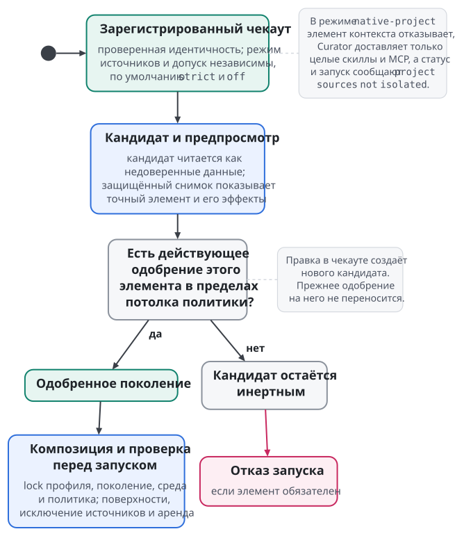
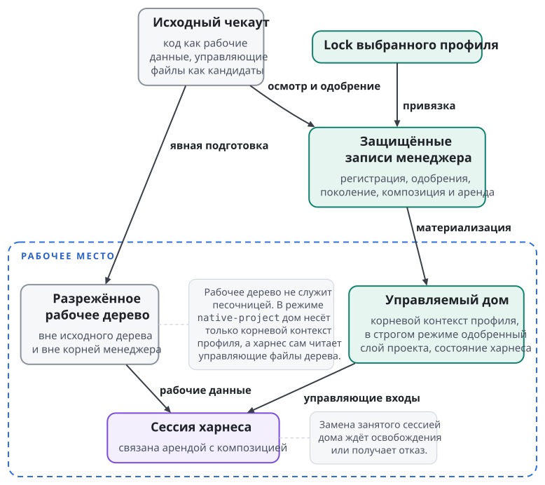
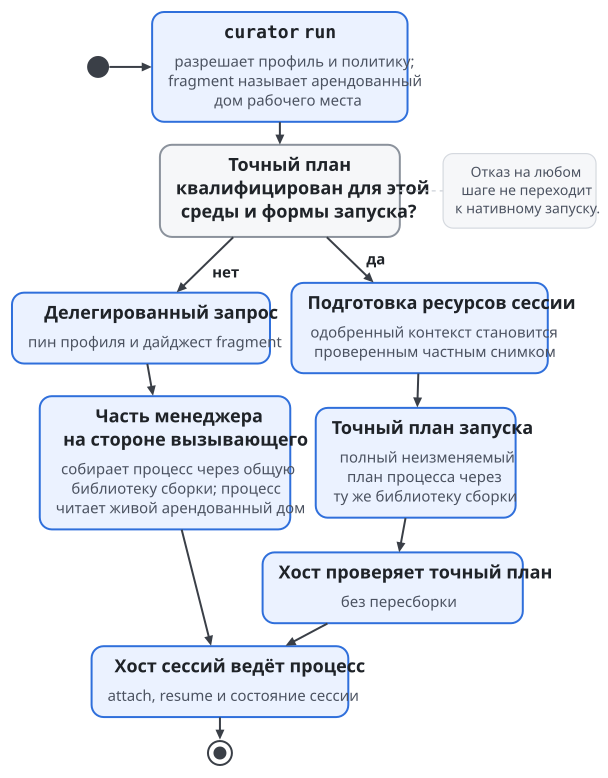

# Контекст проекта и рабочее место

Профиль полезен тем, что повторяется между проектами. Проекту нужны свои правила: где проходят границы модулей, как устроена схема данных, какой скилл проверяет миграции и к какому MCP-серверу можно обращаться. **Контекст проекта** добавляет такие сведения к выбранному профилю для одного чекаута. Каждый его элемент проходит отдельное одобрение оператора, и Curator хранит одобренное в записях менеджера вне репозитория. Устройство задаёт контракт контекста проекта в управляемых запусках (CIP-0002).

Репозиторий при этом остаётся рабочими данными агента. Агент читает и правит его код, но ни один файл репозитория не становится инструкцией, инструментом или разрешением без одобрения. Харнес по умолчанию сам ищет в чекауте `CLAUDE.md`, `AGENTS.md`, скиллы, хуки и настройки (глава "Агентские среды и харнесы"). Контекст проекта определяет, что из этого доходит до сессии и по какому каналу.

## Регистрация задаёт идентичность чекаута

**Регистрацией** называется защищённая запись менеджера, которая связывает чекаут с выбранным профилем и агентской средой. Менеджер выдаёт чекауту случайный идентификатор и привязывает к нему канонический корень Git, сетевой адрес основного remote или явный случай без remote, единственный корневой коммит, устройство и inode каталога, дайджест lock-файла профиля и режим источников. Читаемое имя служит оператору, а полномочия берутся только из записи менеджера. Репозиторий не может зарегистрировать себя файлом внутри `.git` или полем своего манифеста.

Оператор регистрирует чекаут командой:

```sh
curator project register ./demo --name demo --profile dev --environment codex_cli
```

Команда печатает запись регистрации в JSON, в том числе `checkout_id`, `mode` и ссылки на будущие дом и рабочее дерево. Без `--name` имя берётся из имени каталога. Каталог менеджера обязан лежать вне чекаута, иначе регистрация отказывает: записи менеджера внутри дерева репозитория защитить нельзя.

Пример. Два чекаута проекта `catalog` содержат одинаковые коммиты. Второй не получает одобрений первого, потому что у него другой идентификатор и другая привязка к файловой системе. Замена дерева по старому пути тоже не сохраняет полномочий: менеджер сверяет привязку к репозиторию и inode при каждом использовании. После переноса чекаута или при неоднозначности оператор перепривязывает его явно:

```sh
curator project rebind CHECKOUT_ID ./demo
```

Перепривязка закрывает старую запись и выдаёт новый идентификатор без единого одобрения. Замеченный разрыв привязки менеджер сохраняет как утрату полномочий корня, и все слоты этого корня утрачивают полномочия вместе. Восстановление прав доступа или возвращение того же inode старую регистрацию не оживляет. Отозвать одобрение можно и тогда, когда исходного чекаута уже нет. Вложенные регистрации разрешаются по самому глубокому зарегистрированному корню.

Регистрация ничего не одобряет. Новая регистрация получает строгий режим и выключенный допуск: знание о том, где лежит проект, не разрешает его настроек.

## Режим источников и допуск

У каждой регистрации два независимых переключателя. **Режим источников** решает, кто читает управляющие файлы репозитория: Curator через одобренные копии или сам харнес по своим правилам. **Допуск** (`admission`) решает, доставляет ли Curator одобренные элементы проекта. Режим принимает значения `strict` и `native-project`, допуск принимает значения `off` и `admitted`. Новая регистрация получает `strict` и `off`.

**Строгий режим** (`strict`) исключает все неодобренные нативные источники проекта. К ним относятся инструкции предков, текущего и вложенных каталогов, конфигурация и файлы разрешений, корни скиллов, MCP, хуки, плагины и автоматическая память. Исключение действует при старте, перезагрузке, позднем обнаружении, возобновлении и входе дочернего агента. Затем Curator доставляет только защищённые копии одобренных контекста, скиллов и MCP, а одобренный контекст проекта дописывает ниже корневого контекста профиля. Если одобренных MCP-серверов нет, адаптер передаёт явный пустой набор. Строгий запуск требует адаптера, квалифицированного на исключение нативных источников для точного выпуска харнеса и платформы. Без такого адаптера строгий запуск отказывает с `project_context_unsupported` и в другой режим не переходит.

**Режим `native-project`** оставляет обнаружение источников харнесу. Харнес читает инструкции, конфигурацию, скиллы, MCP, хуки и плагины репозитория по своим правилам. Curator доставляет из проекта только одобренные целые скиллы и одобренные MCP-серверы, с их пинами, аудитом и защищённым владением. Управляемый документ инструкций содержит только корневой контекст профиля: харнес и так читает инструкции репозитория, и вторая управляемая копия задвоила бы их. Выбранный элемент контекста в этом режиме отказывает с `project_context_unsupported`, даже необязательный, и оператор явно выбирает поколение без него. Статус и вывод запуска говорят ровно `project sources not isolated`, в том числе при выключенном допуске.

Оба режима одинаково обращаются с разрешениями и памятью. Менеджер программирует разрешения харнеса с запретом по умолчанию, файлы разрешений проекта на эту политику не влияют, нативная память выключена. Адаптер, который не может обеспечить хотя бы одно из этих требований, отказывает с `project_context_unsupported`. Квалификация проверяет их действительный эффект при старте, перезагрузке, возобновлении и входе дочернего агента; заявленного флага для неё мало.

Таблица сравнивает режимы по поверхностям:

| Поверхность | `strict` | `native-project` |
| --- | --- | --- |
| Инструкции репозитория | Исключены; одобренный контекст проекта дописан ниже корня профиля | Харнес читает их сам; управляемый документ содержит только корень профиля |
| Конфигурация, хуки и плагины репозитория | Исключены | Харнес загружает их по своим правилам |
| Скиллы и MCP проекта | Только одобренные защищённые копии | Одобренные целые скиллы и MCP от Curator и нативное обнаружение харнеса |
| Разрешения | Политика менеджера с запретом по умолчанию | Политика менеджера с запретом по умолчанию |
| Нативная память | Выключена | Выключена |
| Сообщение в статусе и при запуске | Нет | `project sources not isolated` |
| Условие запуска | Квалифицированы исключение источников, разрешения и выключение памяти | Квалифицированы разрешения и выключение памяти |

Режим `native-project` защищает пины и аудит доставленных Curator скиллов и MCP, политику разрешений менеджера и выключенную память. Изоляции от содержимого репозитория он не даёт: нативные источники могут добавить сессии больше, чем одобрил оператор. Нативное доверие харнеса к каталогу одобрением элемента не считается.

Режим выбирается для тройки "зарегистрированный чекаут × профиль × агентская среда". Регистрация, композиция и fragment несут одно и то же значение. Расхождение или неизвестный режим отказывают с `project_context_invalid` до публикации. Включить `native-project` может только явное защищённое действие оператора; файл репозитория, неудачная строгая квалификация или умолчание адаптера режим не меняют. Смена режима создаёт новые идентичности регистрации и композиции и подчиняется правилу занятого дома (раздел "Аренда удерживает управляющее состояние").

Пример. Оператор доверяет собственному репозиторию и хочет, чтобы Codex читал его `AGENTS.md` и `.codex/config.toml` как обычно. Он включает `native-project` для этого чекаута, профиля `dev` и среды `codex_cli`. Одобренный проектный скилл миграций Curator доставляет защищённой копией, разрешения задаёт менеджер, и каждый запуск печатает `project sources not isolated`. Для чужого форка тот же оператор оставляет `strict`.

Отчёт о регистрации выводит режим отдельно от допуска:

```sh
curator project inspect CHECKOUT_ID
```

В JSON-ответе поля `mode`, `admission` и `memory` стоят отдельно от списка кандидатов. Регистрация в режиме `native-project` получает поле `notice` с текстом `project sources not isolated` до одобрения первого элемента.

Запуск в незарегистрированном чекауте остаётся в явно отмеченном состоянии совместимости: харнес обнаруживает источники как обычно. Это состояние не совпадает ни с `off`, ни со строгим режимом. Политика парка может требовать регистрации и отказывать таким запускам. Незарегистрированный чекаут контекста проекта неявно не получает.

## Кандидаты

**Кандидатом** называется найденный или явно предложенный элемент управляющего контекста проекта. Обнаружение обходит только известные корни управляющих файлов и читает их как недоверенные данные. Оно не выполняет хуков, не подключает MCP-серверов, не устанавливает пакетов, не исполняет инициализацию оболочки и не скачивает адресов из ссылок. Предпросмотр раскрывает будущий эффект элемента и полномочий ему не даёт.

{.tall}

Запись элемента знает три типа: `context`, `skill` и `mcp`. Правила, знания и нативная конфигурация остаются инертными кандидатами без собственного типа. Хуки, плагины, произвольные нативные настройки и доставка приватной памяти тоже не становятся элементами от включения какой-либо категории. Файлы разрешений проекта никогда не импортируются; их можно предъявить только как инертную просьбу к отдельному процессу выдачи грантов.

Элемент контекста представляет снимок одного корня контекстного пакета. В корне лежит явный `agent-context.json` со списком `context.modules`, рядом хранятся lock контекста и полное закреплённое замыкание пакетов. Одиночный `AGENTS.md` элементом по имени файла не становится. Чтобы принять такие байты, оператор явно упаковывает файл:

```sh
curator project package CHECKOUT_ID instructions --source AGENTS.md
```

Команда берёт один найденный `AGENTS.md` или `CLAUDE.md` и сохраняет его байты без изменений. Она пишет манифест ровно с этим модулем и сохраняет снимок и lock вне репозитория. Флаг `--optional` явно разрешает пропуск элемента. Менеджер никогда не выбирает за оператора неодобренную точку входа.

Замыкание элемента контекста содержит только участников контекста. Непустые `requires.skills`, `requires.mcp` или `codex_settings` в любом участнике приводят к отказу: одобрение контекста не может попутно включить скилл, MCP-сервер или нативную настройку. Скиллы и MCP проходят отдельными элементами со своими одобрениями. Директива нативного импорта в выбранном модуле тоже приводит к отказу, даже если её цель лежит внутри снимка. Обычная ссылка в прозе остаётся данными.

Элемент целого скилла требует явного манифеста пакета, `SKILL.md` с корректными полями `name` и `description`, полного снимка, пина содержимого и строгого аудита только для чтения. Произвольный каталог исполняемым скиллом не становится. Предпросмотр скилла выводит манифест, инструкции, исполняемые исходники, владельцев команд, запрошенные возможности и эффект на разрешения. Запрошенные возможности остаются инертными просьбами, потому что разрешения программирует только политика менеджера.

Снимок проверяется целиком. Пути в нём уникальны и переносимы, в них нет ссылок, псевдонимов по регистру или нормализации и выходов за корень. Снимок ограничен 10 000 файлами, глубиной 32, 240 байтами UTF-8 на путь, 16 МиБ на файл и 64 МиБ в сумме. Кандидат с известным файлом нативного логина (`auth.json`, `.credentials.json`, `config/muse/auth.json`) отказывает целиком до публикации снимка. Эта проверка по имени файла общим обнаружением секретов не служит.

Оператор проходит путь от регистрации до одобрения так:

1. `curator project register ./demo --name demo --profile dev --environment codex_cli` печатает регистрацию с `checkout_id` и `"mode": "strict"`.
2. `curator project inspect CHECKOUT_ID` печатает режим, допуск и список кандидатов.
3. `curator project package CHECKOUT_ID instructions --source AGENTS.md` упаковывает выбранный файл в элемент `instructions`.
4. `curator project preview CHECKOUT_ID` печатает манифест, байты модуля, полный перечень файлов, замыкание, изменения и дайджест пакета ревью.
5. `curator project approve CHECKOUT_ID instructions --digest ITEM_SHA256 --package-digest REVIEW_SHA256` записывает защищённое одобрение точного элемента.
6. `curator project revoke CHECKOUT_ID instructions` отзывает это одобрение.

Для скиллов и контекстных пакетов из каталога предпросмотр принимает закрытый запрос `--declaration request.json` версии 1. У каждого элемента запроса шесть обязательных полей, а неизвестные поля, повторы ключей и `null` приводят к отказу.

## Одобрение относится к каждому элементу

**Одобрение** фиксирует точный элемент и его дайджест, чекаут, агентскую среду, одобрившего и потолок политики. Включение категории разрешает рассматривать её элементы и ни один из них не одобряет. Агент одобряет только в пределах действующего гранта, который менеджер выдал на это действие. Ни человек, ни агент не обходят неизменяемых запретов парка и менеджера. Дайджест опознаёт содержимое и полномочий не даёт, а одобрение из файла в репозитории полномочием не считается.

Пример. Оператор одобрил пакет с двумя модулями контекста. Автор проекта переставил записи в `context.modules`, оставив те же файлы. Новый порядок изменил снимок и дайджест элемента, и прежнее одобрение такого кандидата не покрывает: запуск отказывает с `project_item_unapproved`. Если кто-то изменил сохранённые защищённые байты под старым дайджестом, это дрейф (`project_context_drift`), и новой базой он не становится.

Одобрение старого предпросмотра отказывает, если выбранный исходный файл с тех пор изменился. Изменённый файл требует новой упаковки и нового ревью и никогда не переписывает одобренных ранее байтов. Обязательный элемент с действующим одобрением нельзя молча выключить или удалить. Пропуск необязательного элемента записан явно и назван.

Для MCP-сервера, объявленного прямо в Skillfile проекта, одобрение связывает идентичность проекта, имя сервера и дайджест нормализованного объекта `server`. Новый адрес, другой порядок аргументов, добавленное имя переменной окружения или другой набор сред требуют нового решения. Простой URL HTTPS тоже является управляющим вкладом и неявно не одобряется. Переименование сервера или перенос объявления в другой проект старого одобрения не воспроизводят.

Нормализация раскрывает сокращённую запись URL, заменяет отсутствующий `env_names` пустым списком, сортирует имена переменных и явно названные среды. Скалярные значения и порядок аргументов команды она сохраняет. Дайджест сервера, дайджест объявления и идентичность исходного манифеста решают разные задачи и друг друга не подменяют. Грамматика объявления принадлежит контракту объявлений MCP-серверов в Skillfile проекта (CIP-0022).

## Поколение и композиция

**Поколением** называется упорядоченный список одобренных элементов. Порядок списка задаёт порядок вывода. Правки в чекауте создают кандидатов для следующего поколения, а действующее поколение за ними не следует. Предпросмотр следующего поколения выводит изменённый текст, изменения зависимостей, владельцев команд, транспорты и адреса MCP и эффект на разрешения.

**Композиция** связывает поколение с lock-файлом выбранного профиля, агентской средой, режимом, адаптером, эффективной политикой, `memory: "off"`, домом и рабочим деревом. Это отдельная производная запись. Новым lock-файлом профиля она не становится и профиль, которым пользуются другие проекты, не меняет. Записи регистрации и композиции закрыты: неизвестные поля, повторы ключей и `null` приводят к отказу, а идентичность записи равна SHA-256 её канонических байтов.

В строгом режиме корневые инструкции соединяются в порядке главы "Слои контекста". Первым идёт корневой документ профиля, за ним документы контекста проекта: сначала общий для проекта, затем специфичный для среды, более глубокая область после более мелкой. Пустые документы пропускаются, между непустыми стоит ровно один дополнительный перевод строки. Системные части идут отдельным каналом системного промпта со своим правилом соединения. Проект никогда не заменяет корневой или системный контекст профиля, его контекст только дописывается. Адаптер, который не может воспроизвести такой вывод, отказывает. В режиме `native-project` оба управляемых документа содержат только профиль.

Скиллы с одинаковым пином сливаются в один. Проектный скилл той же идентичности с другим содержимым заменяет весь скилл, включая контекст, команды и провайдеры, и менеджер заново проверяет требования по всему эффективному замыканию. Если два разных скилла экспортируют одно имя команды, композиция отказывает, и случайный порядок файлов победителя не выбирает. MCP-серверы с одинаковым идентификатором и дайджестом сливаются, а другой сервер под тем же идентификатором требует явного одобрения замены. Обязательный элемент нельзя потерять под видом необязательного пропуска. Пропуск с причиной `disabled` или `unsupported` возможен только для элемента, необязательность которого записана в одобрении и видна в предпросмотре.

Композиция несёт опись материализации: путь, SHA-256, размер и режим (`0600` или `0700`) каждого созданного управляющего файла. Изменяемое нативное состояние, учётные данные и исходное рабочее дерево в опись не входят. Перед стартом менеджер сверяет файлы с описью, и получатель не может узаконить изменённые файлы заменой базы.

## Рабочее место

**Рабочим местом (Werkstatt)** называется постоянный управляемый дом для тройки "чекаут × профиль × агентская среда", которым владеет менеджер. Дом лежит по пути `environments/project-views/<checkout-id>/<profile>/<env>/` и соединяет базовый профиль, одобренный оверлей проекта и изменяемое нативное состояние харнеса. Рабочее место живёт дольше отдельного поколения. После обновления в простое логин и состояние сессий сохраняются, и новый дом на каждый дайджест не нужен. Нативная раскладка дома остаётся за адаптером, включая четыре родительских каталога XDG у Muse.

{.tall}

Рядом с домом менеджер держит разрежённое рабочее дерево (sparse worktree). Оно лежит вне дерева исходного репозитория и вне корней полномочий и хранилища менеджера. Композиция связывает идентичность исходного чекаута, выбор файлов и идентичность рабочего дерева. Изменённые входы требуют явной подготовки и сами не синхронизируются. Скиллы, их защищённые командные артефакты и CLI принадлежат рабочему месту. В строгом режиме нативное доверие харнеса относится только к подготовленному рабочему дереву и не одобряет других элементов. Разрежённое дерево готовит рабочую поверхность харнеса, но исключения нативных источников не доказывает и песочницей против враждебного кода не служит.

Пример. Два проекта с профилем `review` получают разные рабочие места. Профили `review` и `development` одного чекаута тоже не делят нативного состояния. По сравнению с парой "профиль × агентская среда" у управляемого дома появляется третье измерение (глава "Управляемый дом"). Перенос одобрений или нативного состояния между рабочими местами требует собственного основания.

Каждое новое рабочее место означает новый первый вход в харнес. Claude в рабочем месте получает setup-token через отдельно допущенный канал учётных данных. Нативное состояние логина не копируется, и тихого перехода к другому источнику нет: недоступный или истёкший токен даёт отказ своего владельца. Учётные данные не попадают в записи проекта, снимки, описи и аренды.

Рабочее место рассчитано на доверенный код. Оператор разрешает код рабочего дерева под грантами менеджера, а строгий допуск источников по-прежнему исключает автоматическую загрузку неодобренного. Процесс без ограничений под тем же UID может изменить состояние менеджера, поэтому права файлов и дайджесты от враждебного кода не защищают.

Долгую сессию в рабочем месте поднимает лаунчер `curator-run` по записи `werkstatt-record-v1`. Запись называет проект, роль, агентскую среду, профиль, клон и отдельный каталог Git. Перед стартом команда `curator run werkstatt up` проверяет, что ни в одном предке клона нет `CLAUDE.md`, `CLAUDE.local.md`, `AGENTS.md` или `AGENTS.override.md`. Затем она сравнивает необязательное поле записи `profile_lock_sha256` с дайджестом lock-файла из fragment. Расхождение отказывает с `werkstatt_profile_lock_mismatch` до записи хуков и до запуска. Команды рабочего места и порядок проверок описаны в главе "Запуски и жизнь сессии".

## Аренда удерживает управляющее состояние

**Аренда** связывает композицию с конкретной сессией и её поколением. Менеджер создаёт аренду в состоянии `prepared` до публикации fragment. До старта провайдера и до выхода запускающего процесса аренда переходит к зарезервированной сессии в состоянии `active`. Состояние `released` наступает только после подтверждённого завершения сессии и её потомков и сверки владения. Прерванное восстановление переводит аренду в `unknown`, и такая аренда удерживает дом и артефакты.

На время аренды восстановление дома, смена профиля, синхронизация скиллов и CLI и замена композиции ждут освобождения или отказывают с `project_view_busy`. Диагностика называет сессию-владельца и советует дождаться её или завершить. Подменить созданные инструкции под работающей сессией и считать прежний дайджест запуска доказательством нового состояния нельзя. Одна композиция обслуживает несколько сессий одного дома, только если адаптер поддерживает одновременный доступ к нативному состоянию.

Отсоединение (detach) аренды не освобождает. Возобновление использует записанную композицию, сегодняшнее действующее поколение на него не влияет. PID и истёкший таймаут по отдельности завершения не доказывают, неизвестная живость сохраняет аренду. Сборка мусора не удаляет арендованных домов, композиций и артефактов сборки и исполнения. Эти гарантии требуют участия хоста сессий: доказательство того, что сессия и её потомки завершились, даёт только он.

Отзыв запрещает новые допуски, запуски и вызовы команд. Уже загруженный нативный контекст из процесса при замене файла не исчезает. Для немедленного прекращения нужен принуждающий канал харнеса или явная остановка и перезапуск сессии.

## Разрешения, память и команды

Разрешения программирует менеджер: сначала запрет по умолчанию, затем гранты в пределах установленного потолка. Байты разрешений из проекта не применяются даже как якобы более строгий вариант, потому что это другой источник полномочий. Агент меняет разрешения только через защищённые гранты. Адаптер, который не может выразить требуемую политику, отказывает.

Пример. Адаптер Claude пишет `settings.json` только из настроек менеджера: отсортированные разрешения и запреты встроенных инструментов и `defaultMode: dontAsk`. Режим `dontAsk` сам по себе запрета по умолчанию не даёт, потому что чтение рабочего каталога проходит без вопроса. Поэтому адаптер добавляет флаг `--tools` ровно с разрешёнными встроенными инструментами, пустой при отсутствии грантов, и запрет `mcp__*`. Файл `.claude/settings.json` репозитория адаптер не читает и не копирует.

Нативная память выключена по умолчанию, и одобрение знаний репозитория её не включает. После явного включения приватная память хранится в своём рабочем месте до явного удаления. Она не публикуется, не переходит в другое рабочее место и не становится одобренным знанием.

Команды скиллов рабочего места запускаются через один защищённый **командный диспетчер** менеджера, связанный с текущей композицией и арендой. Запуск строит `PATH` в таком порядке: защищённый каталог инструментов этого запуска, допущенный базовый `PATH` пользователя в прежнем порядке, затем каталог диспетчера. Если диспетчер уже стоит в базовом `PATH`, он сохраняет свою позицию. Повторы удаляются по идентичности в файловой системе. Каталог `.agents/bin` репозитория и инициализация оболочки (`.agents/env.sh`, `.envrc`) исполняемыми входами такого запуска не становятся.

Преобразование применяется к допущенному `PATH` дочернего процесса. `PATH` родительской оболочки готовой строкой в место назначения не переносится. Пустые, относительные, зависящие от текущего каталога и доступные репозиторию на запись компоненты базового `PATH` дают отказ `project_path_refused`. Каталог, добавленный в конец, не обгоняет старый шим, стоящий раньше. Поэтому менеджер переводит такой шим на тот же диспетчер или отказывает, если шим перехватил бы имя команды. Имена `curator-*` зарезервированы, и поиск провайдеров зонтичной команды каталог диспетчера исключает.

## Ревью чужого кандидата

Кандидатом бывает и чужое изменение кода, например правка, пришедшая на ревью. Доска выдаёт ревьюеру, оркестратору и тестировщику его diff и блобы как инертные ресурсы только для чтения. Ресурсы привязаны к дайджесту и лежат вне всех корней обнаружения харнесов. Харнес не подхватывает из них инструкции, хуки, MCP-серверы, разрешения или скиллы ни при старте, ни при перезагрузке, вложенном обнаружении, возобновлении или входе дочернего агента.

Принятие кода допуском его управляющих поверхностей не считается, и их включение остаётся отдельным решением о контексте проекта. Войти в дерево непринятого кандидата харнесом с обнаружением источников можно только через квалифицированный строгий адаптер или равносильное исключение обнаружения. Режим `native-project` эту границу не ослабляет. Чтение данных без загрузки оставляет остаточный риск смысловой инъекции в промпт.

## Как это входит в запуск

`curator run` служит точкой входа. Зонтичная команда передаёт подкоманду, которой сам Curator не реализует, установленному провайдеру `curator-<имя>`, прежде всего лаунчеру `curator-run`. Сборку процесса и хост сессий ведут внешние компоненты, поэтому успешная передача провайдеру квалификации запуска не доказывает.

{.tall}

Композиция рабочего места выбирается до любого маршрута. Менеджер разрешает профиль и одобренное поколение и берёт аренду дома. Fragment с контекстом проекта называет арендованный дом рабочего места, общий дом профиля в нём не участвует. Если адаптер не поддерживает подмены дома или исключения источников, запуск отказывает и с одним базовым профилем не стартует.

Такой fragment несёт член `project_context`: версию, режим, допуск, ссылку и дайджест композиции, корень проекта и ссылку на аренду. Корень проекта совпадает с регистрацией. Член `command_environment` описывает проверенное преобразование `PATH` и требует адаптера, квалифицированного для команд. Опубликованные версии fragment этих членов не принимают, и потребитель, не понимающий новой версии, отказывает до создания сессии.

На **делегированном маршруте** `curator-run` разрешает профиль и fragment, модель и усилие, разрешения, системный промпт, типизированное возобновление и намерение по учётным данным и отправляет закрытый запрос. Компонент менеджера сессий на стороне вызывающего собирает процесс в общем месте сборки команды запуска, с арендованным домом рабочего места и квалифицированным адаптером. Он сверяет дайджест fragment с запросом и ничего от себя не добавляет. Маршрут опирается на живой дом, пин профиля и дайджест fragment, снимка сессии у него нет. Поэтому пин и дайджест fragment неизменности контекста сессии не доказывают.

На **маршруте точного плана** вызывающий материализует одобренное содержимое в зарезервированный дом сессии по контракту снимков управляемых домов (CIP-0014) и запечатывает полный процесс. Идентичность процесса покрывает рабочее место, аренду, снимок, наложение политики и итоговый `PATH`. Хост проверяет и исполняет этот план без пересборки. Запасного пути с сырой копией дома нет. Исходное рабочее место остаётся арендованным до сверки состояния сессии после её завершения. Подключённая и отсоединённая формы, возобновление и уведомления требуют квалификации на конкретном харнесе, сборке и платформе.

Отказ делегированного маршрута или отсутствие возможности точного плана не дают права тихо запустить нативный харнес с другим окружением. Выбор маршрута и вывод делегированного маршрута из работы идут по каждому харнесу отдельно, и успех другого харнеса основанием не служит. Форматы запросов и команды разобраны в главе "Запуски и жизнь сессии".
