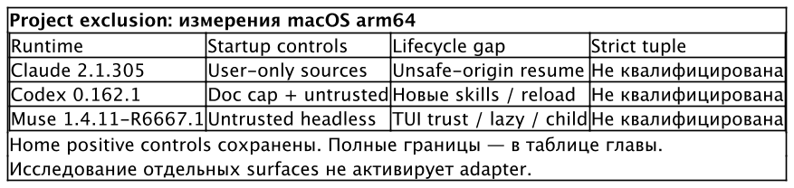

# Environments и harnesses

Профиль описывает содержимое окружения. Harness определяет, как это содержимое
попадает в сессию: читает ли он `AGENTS.md`, ищет ли skills выше текущего
каталога, объединяет ли MCP-конфигурации. Одинаковые файлы в двух домашних
каталогах не означают одинакового поведения двух программ.

**Adapter** — код менеджера, который знает поддерживаемые поверхности одного
environment. Он задаёт расположение home, instruction target, допустимые
формы root context, каналы system prompt и MCP, seeds и credential strategy.
Пакет контекста выбирает применимость своего текста, но не добавляет adapter
и не меняет его argv-контракт. Реестр закрыт. ⟦работает сегодня⟧

## Какие среды входят в реестр

Таблица показывает материализацию в коде Curator, а не сертификат исключения
всех посторонних источников. `<home>` означает home выбранной пары
profile × environment. CLI принимает короткие имена `claude` и `codex`,
но в locks, fragments и конфигурации используются canonical IDs.
⟦работает сегодня⟧

| Environment | Как выбирается home | Root instructions | Skills |
| --- | --- | --- | --- |
| `claude_code` | `CLAUDE_CONFIG_DIR` | `CLAUDE.md` | `skills/` внутри home |
| `codex_cli` | `CODEX_HOME` | `AGENTS.md` | `skills/` внутри home |
| `opencode` | `XDG_CONFIG_HOME`, home — его дочерний `opencode/` | `AGENTS.md` | Машинная native surface `.agents/skills`, вне этого home |
| `pi` | `PI_CODING_AGENT_DIR` | `AGENTS.md` | `skills/` внутри home |
| `muse` | Четыре XDG parent под home: `config`, `data`, `state`, `cache` | `config/muse/AGENTS.md` | Материализация в `data/muse/skills`; native discovery этого target не квалифицирован |

Gemini, Cursor и Windsurf присутствуют среди skills adapters. Это не делает
их environments с собственным управляемым home. Для OpenCode root context
и skills уже имеют разные области переключения: выбор profile home не
переключает машинную native skills surface. Этот остаток нужно учитывать
даже без project context. ⟦работает сегодня⟧

У Claude доступны monolithic и referenced root context; у Codex, pi и Muse —
monolithic. OpenCode допускает обе формы, но часть его native свойств
основана на документации, а не runtime qualification. Muse получает все
четыре XDG override; `HOME` не заменяется. Общая переменная XDG влияет также
на дочерние программы, которые следуют XDG. ⟦работает сегодня⟧

## Resolve отдаёт fragment

**Launch fragment** — описание вклада Curator в будущий процесс. В нём есть
environment, profile name и lock digest, home variables, precedence,
permissions и применимые channel descriptors. Descriptor сообщает, как
передать подготовленный файл: flag, config key, variable или file.
Fragment не является готовой командой shell. ⟦работает сегодня⟧

```sh
curator env resolve codex --profile review --format json
```

При установленном профиле и исправном home команда возвращает проверенный
fragment. Обычный resolve не означает «найти свежую версию профиля»:
используется существующий lock. Вариант `--repair` разрешает provisioning
и repair; `--preserve-lock` запрещает ремонт ценой изменения lock.
Разницу между проверкой и записью важно сохранить в автоматизации.
⟦работает сегодня⟧

Launcher потребляет fragment, выбирает native form harness и собирает argv,
полное env, cwd и stdin. Один construction site нужен, чтобы интерактивный
запуск и запуск через host не придумывали разные способы включения
system prompt, credentials или permissions. Сам resolve не запускает
harness и не применяет его MCP flags. ⟦решено⟧

## Seeds не заменяют policy

**Seed** — native настройка, которую менеджер переносит при provisioning
по правилам adapter. Это отдельный источник от генерируемого root context.
Claude использует `.claude.json`; Codex — `config.toml`; pi — `settings.json`
и `models.json`; Muse — собственные settings и trust. У каждого переноса
свои правила владения и последующих записей runtime. ⟦работает сегодня⟧

Для нового Codex home seed revision B удаляет native `mcp_servers` из
скопированной базы. Дом, созданный по revision A, сохраняет старую базу
и получает диагностику `mcp_seed_unstripped`: новая версия менеджера не
выдаёт старые bytes за очищенную конфигурацию. Это защита конкретного
канала наследования, не отключение project `.codex/config.toml`.
⟦работает сегодня⟧

OpenCode меняет только XDG config parent; data и state остаются ambient.
Для нужных дочерним инструментам config entries существуют allowlisted
seed links. Muse меняет все четыре XDG parent и не получает такого
foreign seeding. Поле `isolated` у credential strategy нельзя читать как
обещание полной изоляции контекста, файловой системы и процессов.
⟦работает сегодня⟧

Profile-level native settings требуют собственного разрешённого набора
полей и способа доставки. Описание Codex settings в спецификации не
разрешает перенос произвольной project TOML. Например, выбор модели
и выбор доверенного MCP endpoint — разные решения; generic merge
не может выдать первое за одобрение второго. ⟦спецификация⟧

## Что harness находит сам

Кроме managed home, harness может читать текущий checkout и его предков.
Claude ищет семейство `CLAUDE.md`, rules, project skills, hooks и settings;
Codex — instruction chain, `.agents/skills` и trusted project config.
Muse связывает несколько project surfaces с workspace trust. Поверхности
различаются по версии и режиму. Перенос home не отключает их автоматически.

Для strict project-aware запуска требуется исключить неутверждённые
управляющие входы на startup, при lazy read, reload, resume и child entry,
затем доставить только approved copies. Если обязательная поверхность
не контролируется, adapter должен отказать. Ни один из описанных ниже
исследовательских результатов сам по себе не включает такой adapter.
⟦решено⟧

Таблица фиксирует измерения на macOS arm64, а не переносимую гарантию.
«Исключено» означает наблюдение loader/native tool на указанных случаях;
это не доказательство послушания модели. Результаты и отрицательные
контроли опубликованы в qualification-документах Curator.

| Runtime и версия | Что исключили при сохранении home control | Где граница |
| --- | --- | --- |
| Claude Code 2.1.305 | `--setting-sources user`: измеренные root/ancestor/nested instructions, rules, skills, hooks, project plugin и settings. MCP проверен также с отдельным strict channel | Safe-origin resume и один background child измерены. Unsafe-origin transcript сохраняет прежний project text и при resume, и при fork. Все lifecycle варианты не покрыты |
| Codex 0.162.1 | `project_doc_max_bytes=0` убирает project instructions. Protected workspace `untrusted` исключает измеренные hooks, plugin enablement, MCP и config | Project skills переживают эти controls; disabling известных paths не запрещает новый skill и `forceReload`. Resume baseline не различает случаи, child entry не измерен |
| Muse Code 1.4.11-R6667.1 | Fresh untrusted headless home исключает измеренные project rules/skill catalogs, hook и MCP config source; home controls сохранены | MCP проверен на уровне config, без успешного server handshake. TUI resume требует trust или quit; после trust живые surfaces возвращаются. Lazy tool read, children и late reload не квалифицированы |

{.landscape}

Исследовательские harnesses и проверки этих случаев уже есть в репозитории.
Они устанавливают ровно перечисленные наблюдения. Полная strict
qualification для Claude, Codex и Muse из них не следует; автоматически
поднимать статус runtime adapter по успешному research test нельзя.
⟦работает сегодня⟧

Для pi документация и startup probe различают native trust и чтение
instructions. Сочетание resource-disable flags, `--no-context-files` и
явных manager-owned путей ещё требует проверки как единый маршрут.
У OpenCode версии с разными правилами discovery должны иметь разные
qualification rows; документированный выключатель project config не
доказывает отсутствие всех остальных project inputs. ⟦открыто⟧

## Как читать результат проверки

Хороший отчёт отвечает на узкий вопрос. «Домашний skill остался, project
skill исчез после reload на этой версии» полезнее общего слова «isolated».
Если control без исключающего флага тоже не увидел project source, опыт
не различает рабочую защиту и неактивный loader. Именно поэтому поздний
hook без положительного baseline или resume без project marker не
считаются подтверждением exclusion.

Перед новым runtime release нужны повторяемые положительные и
отрицательные случаи, сохранённый home control, измеренный lifecycle
и явные gaps. Успех root-instruction проверки не закрывает MCP или
permissions. Глава «Безопасность, permissions и trust» объясняет,
почему даже полное source exclusion остаётся лишь одной из границ.
