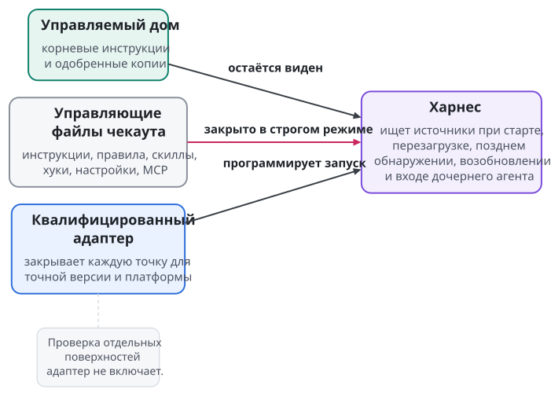

# Агентские среды и харнесы

Профиль описывает содержимое окружения. **Харнесом** называется программа, которая ведёт сессию модели и исполняет вызовы инструментов, например Claude Code, Codex или Muse. Харнес определяет, как содержимое профиля попадает в сессию: читает ли он `AGENTS.md`, ищет ли скиллы выше текущего каталога, объединяет ли конфигурации MCP. Одинаковые файлы в двух домашних каталогах не дают одинакового поведения двух программ.

Реестр Curator знает пять агентских сред (глава "Для кого эта книга"): `claude_code`, `codex_cli`, `opencode`, `pi` и `muse`. **Адаптером** называется код менеджера, который знает поддерживаемые поверхности одной агентской среды. Он задаёт расположение дома, файл корневых инструкций, допустимые формы корневого контекста, каналы системного промпта и MCP, начальные файлы и стратегию учётных данных. Контекстный пакет выбирает, к каким средам применим его текст, но адаптера не добавляет и его контракт аргументов не меняет. Реестр адаптеров закрыт, и неизвестный идентификатор отказывает с `environment_unknown`.

## Реестр агентских сред

Таблица описывает, как Curator материализует дом каждой среды. Исключения всех посторонних источников она не удостоверяет. `<home>` означает дом выбранной пары "профиль × агентская среда".

| Агентская среда | Как выбирается дом | Корневые инструкции | Скиллы |
| --- | --- | --- | --- |
| `claude_code` | `CLAUDE_CONFIG_DIR` | `CLAUDE.md` | `skills/` внутри `<home>` |
| `codex_cli` | `CODEX_HOME` | `AGENTS.md` | `skills/` внутри `<home>` |
| `opencode` | `XDG_CONFIG_HOME`; дом является его дочерним каталогом `opencode/` | `AGENTS.md` | Машинный нативный каталог `.agents/skills` вне `<home>` |
| `pi` | `PI_CODING_AGENT_DIR` | `AGENTS.md` | `skills/` внутри `<home>` |
| `muse` | Четыре родительских каталога XDG внутри `<home>`: `config`, `data`, `state`, `cache` | `config/muse/AGENTS.md` | `data/muse/skills` внутри `<home>` |

CLI принимает короткие имена `claude` и `codex` и сразу переводит их в канонические идентификаторы. Lock-файлы, fragment, маркеры, диагностика и конфигурация несут только канонические идентификаторы.

Gemini, Cursor и Windsurf встречаются среди адаптеров установки скиллов в проект: у Gemini это `.gemini/skills`, у Cursor `.cursor/rules`, а Windsurf и OpenCode сами читают канонический `.agents/skills`. Собственного управляемого дома у них нет, и агентскими средами они не являются. У OpenCode корневой контекст и скиллы переключаются в разных областях: выбор дома профиля не переключает машинный каталог скиллов. Этот остаток нужно учитывать и без контекста проекта.

Корневой контекст у Claude и OpenCode допускает формы `monolithic` и `referenced`, у Codex, Pi и Muse только `monolithic` (глава "Слои контекста"). Muse получает все четыре переменные XDG, а `HOME` не заменяется. Общая переменная XDG влияет и на дочерние программы, которые следуют XDG. У Pi файл `AGENTS.override.md` в доме затеняет корневой контекст, и менеджер сообщает о нём диагностикой `environment_shadowing_path_present`.

Реестр записывает для каждой среды проверенный выпуск харнеса и команду, которой менеджер узнаёт установленную версию. Для OpenCode проверенного выпуска в реестре нет, и часть его нативных свойств известна только из документации. Реестр менеджера из пяти сред не означает лаунчера на пять сред: лаунчер отказывает с `env_unsupported` для среды, у которой нет отображения на запуск.

Кроме сред реестр знает вторичные цели. Встроенный агент Xcode пользуется домом Claude или Codex в роли `CLAUDE_CONFIG_DIR` или `CODEX_HOME` и получает только корневой контекст и скиллы. Конфигурация MCP и команды встроенного хоста остаются вне этой возможности и аудита.

## Команда resolve выдаёт fragment

**Fragment** (launch fragment) описывает вклад Curator в будущий процесс. В нём есть агентская среда, имя профиля и дайджест lock-файла, переменные дома, порядок приоритета, разрешения и применимые описания каналов. Описание канала говорит, как передать подготовленный файл: флагом, ключом конфигурации, переменной окружения или файлом в доме. Готовой командой оболочки fragment не является.

Для Claude, Codex, OpenCode и Pi менеджер выдаёт `launch-env-fragment-v2`. Для Muse, а также когда fragment несёт выбор хранилища учётных данных или факт о корневом контексте, он выдаёт `launch-env-fragment-v4`. Поле `root_context` у Muse сообщает лаунчеру через интерфейс, что выданный корневой контекст исключительный, и лаунчеру не нужно угадывать это по файлам. Необязательный член `path_prepend` менеджер не выдаёт.

Вызов для профиля `review` и среды Codex выглядит так:

```sh
curator env resolve codex --profile review --format json
```

При установленном профиле и исправном доме команда возвращает проверенный fragment. Обычный resolve использует существующий lock и свежую версию профиля не ищет. Флаг `--repair` разрешает создать или восстановить дом под блокировкой изменений, а `--preserve-lock` запрещает восстановление, которое изменило бы дайджест lock. Флаг `--format` принимает `json`, `env` и `shell`. Автоматизация, которая только проверяет дом, вызывает resolve без `--repair`, и тогда проверка ничего не пишет.

Лаунчер потребляет fragment, выбирает нативную форму харнеса и собирает argv, полное окружение, рабочий каталог и stdin. Одна библиотека сборки нужна, чтобы интерактивный запуск и запуск через хост не придумывали разных способов включить системный промпт, учётные данные или разрешения. Resolve сам харнес не запускает и флагов MCP не применяет.

## Начальные файлы не заменяют политику

**Начальным файлом** (seed) называется нативная настройка, которую менеджер переносит из нативного дома харнеса при создании управляемого дома по правилам адаптера (глава "Управляемый дом"). Это отдельный источник рядом с создаваемым корневым контекстом. Claude получает `.claude.json`, Codex `config.toml`, Pi `settings.json` и `models.json`, Muse `config/muse/settings.json` и `config/muse/trust.json`. Менеджер читает начальные файлы только при создании дома. Восстановление их не обновляет, и после создания они принадлежат харнесу.

Новый дом Codex получает начальный файл по ревизии C. Ревизия удаляет из копии `config.toml` таблицу `mcp_servers` и всю таблицу `projects` с нативным доверием к проектам, а остальные ключи сохраняют свои значения. Если ни одной из этих таблиц нет, байты копируются без изменений. Неразборчивый TOML отказывает с `environment_seed_unreadable` до первой записи в дом. Удалённые серверы называет предупреждение `mcp_native_servers_not_inherited`. Доверие к каталогам управляемые дома получают из журнала доверия Curator (глава "Безопасность, разрешения и доверие").

Ревизия записана в маркере дома, и менеджер её не переписывает. Дом, созданный по ревизии A, сохраняет унаследованные серверы MCP и получает диагностику `mcp_native_servers_ungoverned` и `mcp_seed_unstripped`: новая версия менеджера не выдаёт старые байты за очищенную конфигурацию. Дом ревизии B сохраняет скопированное доверие к проектам. Новую ревизию к старому дому применяет только явное пересоздание дома. Эта защита закрывает один канал наследования из нативного дома, и файл `.codex/config.toml` проекта она не отключает.

OpenCode меняет только родительский каталог конфигурации XDG, а данные и состояние остаются общими с машиной. Для записей конфигурации, нужных дочерним инструментам, есть ссылки по разрешённому списку. Muse меняет все четыре родительских каталога XDG и такого стороннего засева не получает. Значение `isolated` у стратегии учётных данных относится к хранению логина и полной изоляции контекста, файловой системы и процессов не обещает.

Нативные настройки на уровне профиля требуют закрытого словаря полей и своего способа доставки. Профиль объявляет настройки Codex в манифесте пакета полем `codex_settings`. Curator передаёт их лаунчеру типизированными данными, и лаунчер применяет их парами `-c key=value` при каждом управляемом запуске, не переписывая `config.toml` (контракт настроек Codex на уровне профиля, CIP-0018). Словарь пакета ключей не допускает, и манифест принимает только пустой `codex_settings`. Выбор хранилища учётных данных Codex принадлежит машинному селектору оператора, пакет его не задаёт. Произвольный TOML проекта этим путём не переносится. Выбор модели и выбор доверенного MCP-сервера являются разными решениями, и общее слияние конфигураций не может выдать первое за одобрение второго.

## Что харнес находит сам

Кроме управляемого дома харнес читает текущий чекаут и его предков. Claude ищет семейство `CLAUDE.md`, правила `.claude/rules`, скиллы, хуки и настройки проекта и `.mcp.json`. Codex читает цепочку `AGENTS.override.md` и `AGENTS.md` от корня до рабочего каталога, `.agents/skills`, хуки, плагины и `.codex/config.toml` доверенного проекта. Muse связывает с доверием к рабочему пространству сразу несколько поверхностей проекта: правила, каталоги скиллов `.agents/skills`, `.codex/skills` и `.claude/skills`, хуки `.muse/hooks.json` и `.mcp.json`. Поверхности различаются по версии и режиму, и перенос дома их не отключает.

Строгий запуск с контекстом проекта требует исключить неодобренные управляющие входы при старте, ленивом чтении, перезагрузке, возобновлении и входе дочернего агента и затем доставить только одобренные копии (глава "Контекст проекта и рабочее место"). Если обязательная поверхность не контролируется, адаптер отказывает. Исследовательский результат сам по себе адаптера не включает.

Таблица фиксирует измерения на macOS arm64 для точных сборок и переносимой гарантией не служит. "Исключено" означает, что загрузчик или нативный инструмент харнеса не принял источник в перечисленных случаях; послушания модели это не доказывает. У каждого исключения есть парный положительный контроль, в котором тот же источник загружается без исключающего флага. Результаты и отрицательные контроли опубликованы в документах квалификации Curator.

| Харнес и версия | Что исключено при сохранённом домашнем контроле | Где граница |
| --- | --- | --- |
| Claude Code 2.1.305 | Флаг `--setting-sources user` исключает измеренные инструкции корня, предков и вложенных каталогов, правила, скиллы, стартовые хуки, плагин проекта и настройки. MCP исключается этим флагом или отдельно парой `--strict-mcp-config` и `--mcp-config` с явным файлом, включая пустой набор | Измерены возобновление сессии, начатой с исключением, и один фоновый дочерний агент. Сессия, начатая без исключения, сохраняет текст проекта при возобновлении и при ответвлении. Поздние хуки, плагины, MCP и перезагрузка настроек не измерены |
| Codex 0.162.1 | `-c project_doc_max_bytes=0` убирает инструкции проекта при старте. Явное недоверие проекту в защищённом доме исключает измеренные хуки, включение плагинов, MCP и значения конфигурации | Скиллы проекта переживают оба контроля. Отключение известных путей не останавливает новый скилл и `forceReload`. Возобновление не различает случаев, дочерние агенты и ленивое чтение не измерены |
| Muse Code 1.4.11-R6667.1 | Свежий недоверенный запуск `exec` с пустым хранилищем доверия исключает измеренные правила и каталоги скиллов проекта, хук и источник конфигурации MCP, а домашние копии сохраняются | MCP проверен на уровне конфигурации, без рукопожатия с сервером. Возобновление в TUI предлагает только доверие или выход, и после доверия живые поверхности проекта возвращаются; на 1.4.13-R6996.1 это воспроизводится. Ленивое чтение, дочерние агенты и поздняя перезагрузка не измерены |



Эти исследовательские проверки устанавливают ровно перечисленные наблюдения. Полная строгая квалификация Claude, Codex и Muse из них не следует, и успешный исследовательский тест статуса адаптера не повышает.

Для Pi документация и проба запуска разделяют нативное доверие и чтение инструкций: инструкции загружаются до доверия проекту, а `--no-approve` исключает ресурсы проекта и файлы инструкций не трогает. Кандидатный рецепт для Pi сочетает `--no-approve`, `--no-context-files`, флаги отключения обнаружения ресурсов и явные пути менеджера и обезвреживает `.pi/SYSTEM.md` и `.pi/APPEND_SYSTEM.md`. Сертификация требует проверить это сочетание на точке входа как единый маршрут. У OpenCode версии с разными правилами обнаружения проходят квалификацию отдельными строками. Документированный выключатель `OPENCODE_DISABLE_PROJECT_CONFIG` не доказывает отсутствия остальных входов проекта.

## Как читать результат проверки

Хороший отчёт отвечает на узкий вопрос. Фраза "домашний скилл остался, проектный исчез после перезагрузки на этой версии" полезнее общего слова "изолировано". Если контроль без исключающего флага тоже не увидел источника проекта, опыт не различает работающую защиту и неактивный загрузчик. Поэтому поздний хук без положительной базы или возобновление без маркера проекта подтверждением исключения не считаются. В записи Claude новый хук `PreToolUse` проекта не исполнился даже без флага, и строка позднего хука осталась неизмеренной.

Отказ тоже бывает результатом проверки. В режиме `native-project` Codex 0.162.1 сливает конфигурацию MCP репозитория с переопределениями менеджера: `-c mcp_servers={}` её не стирает, и ключ `disabled_tools` сервера из репозитория убирает инструмент из каталога вопреки полному argv менеджера. Сверка дайджестов конфигурации перед стартом эту границу тоже не закрывает. Codex перечитывает конфигурацию позже, и изменение между проверкой и стартом потока доходит до сессии. Поэтому адаптер Codex отказывает в возможности разрешений и запуска в этом режиме не выдаёт.

Перед поддержкой нового выпуска харнеса нужны повторяемые положительные и отрицательные случаи, сохранённый домашний контроль, измеренный жизненный цикл и явно названные пробелы. Успех проверки корневых инструкций не закрывает MCP и разрешений. Квалификация режима `native-project` строгой квалификацией не считается. Глава "Безопасность, разрешения и доверие" объясняет, почему даже полное исключение источников остаётся лишь одной из границ.
