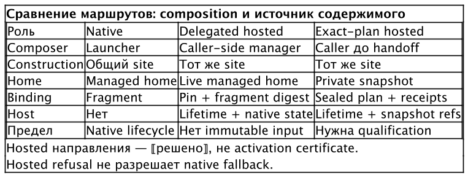

# Запуски и жизнь сессии

Процесс и сессия имеют разный срок жизни. Интерактивный harness может
закончиться вместе с терминалом. Hosted session должна пережить detach,
вернуть точную ссылку для attach и различать остановку, потерю связи
и неизвестную liveness. Поэтому «запустить команду» недостаточно для
описания всего маршрута.

**Native launch** исполняет harness в выбранном окружении без session host.
**Hosted launch** передаёт управление жизнью сессии локальному менеджеру.
**Session manager** — выбранная интеграция, которая предоставляет запуск,
attach, resume и status. Это роль, а не ещё один composer профилей.

## Общая входная точка

В Curator `run` — front door к отдельно установленному provider
`curator-run`. Встроенный CLI разрешает umbrella command через доверенный
installed provider; наличие слова `run` в help не означает, что provider
установлен. Аргументы после `--` принадлежат вызываемой программе.
⟦работает сегодня⟧

```sh
curator run codex -- --help
```

Этот пример показывает границу аргументов. Его исполнение требует
provider и его prerequisites. Для справки о самом Curator существует
`curator help run`; flags hosted, model, effort или resume нужно сверять
с help установленного `curator-run`, а не угадывать по help менеджера
профилей. ⟦работает сегодня⟧

Launcher выбирает environment/profile, разрешает model и effort,
permissions, system-prompt opt-in, credential source и typed resume intent.
Затем общий construction site формирует процесс. Host получает только
разрешённый для его маршрута запрос. Передача в host не должна менять
уже выбранную модель или включать Remote Control. ⟦решено⟧

## Native, delegated и exact

Есть два способа hosted handoff. В переходном **delegated** запросе caller
сообщает разрешённые параметры; caller-side часть session manager собирает
процесс через общий construction site. Он использует live managed home.
В **exact-plan** запросе caller заранее собирает полный процесс и связывает
его с отдельным snapshot. Daemon проверяет и исполняет готовый план.
Так различается место composition, а не только способ transport.
⟦решено⟧

| Свойство | Native | Delegated hosted | Целевой exact-plan hosted |
| --- | --- | --- | --- |
| Кто собирает процесс | Launcher через construction site | Caller-side manager через тот же construction site | Caller до handoff |
| Откуда читается окружение | Выбранный managed home | Live managed home | Curator-materialized private snapshot |
| Что удерживает host | Отсутствует | Сессию и native state по контракту manager | Сессию, snapshot references, admitted plan и provenance |
| Чем связан запуск | Fragment и параметры launcher | Profile pin и fragment digest запроса | Полный plan digest, preparation binding и snapshot receipts |
| Основной предел | Жизнь процесса зависит от native режима | Изменения live home могут быть видны работающей сессии | Требуются совместные carriers, verification API и runtime qualification |

{.landscape}

Переходный delegated маршрут принят и имеет отдельный контракт provider.
Его activation идёт по runtime: Claude и Codex, затем Muse после
квалификации соответствующего consumer. Это не свидетельство готовности
любого установленного session manager. Реестр manager, capabilities и
поддерживаемый build проверяются для конкретного запуска. ⟦решено⟧

При отсутствии выбранного зарегистрированного manager delegated hosted
запуск отказывает. Hosted refusal не превращается в native fallback.
Typed resume также не означает «если не нашли старое, создадим новое».
Например, недоступный host должен оставить запрос неисполненным, а не
открыть другую сессию с похожим именем. ⟦решено⟧

## Почему pin не равен snapshot

Lock digest идентифицирует выбранное содержимое профиля. Работающая
программа может читать native settings и skills с диска позднее startup.
Если кто-то выполнил repair или sync live home, старый pin в записи сессии
не делает прежние bytes доступными. Delegated provenance поэтому слабее
полного exact plan и отдельного immutable input. ⟦решено⟧

**Snapshot** в целевом маршруте материализует Curator, который знает
свои файлы, ownership, relocation и credential exceptions. Launcher
и host не поддерживают параллельный список «нужных файлов» для копирования.
Исходный managed home и private session home имеют разные роли.
⟦решено⟧

Сначала host резервирует identity, generation, private locations и нужный
endpoint. Preparation не запускает harness и не даёт полномочий на запуск.
Curator материализует home в подготовленном месте; caller получает
runtime form, собирает полные argv/env/cwd/stdin и запечатывает план.
Host независимо проверяет reservation, policy, bindings и evidence перед
start. Digest подтверждает совпадение bytes, но не доверенность автора.
⟦решено⟧

Host не добавляет свои env, не ищет binary заново в PATH, не ремонтирует
профиль и не дописывает runtime flags после digest. Для Codex целевой
hosted form — private app-server; для Claude и Muse host владеет PTY.
Политика инструментов имеет закрытый overlay и не разрешает переписать
model, MCP или login. Полная qualification нужна для каждого runtime.
⟦решено⟧

## Detach, resume и doorbell

**Detach** отсоединяет терминал, сохраняя сессию. **Resume** запускает
поддерживаемое native продолжение той же session identity по typed recipe.
**Doorbell** сообщает control plane о событии сессии: это уведомление,
а не произвольная команда из проекта.

Предыдущая exact form не несёт одновременно полноценный detached session
record и doorbell. Поэтому переходный маршрут сохраняет delegated для
таких запросов. Целевой exact successor объединяет attached и detached
forms с durable result и заранее подготовленным doorbell binding.
Уведомление нельзя добавить поздней вставкой в argv или env. ⟦решено⟧

После успешного detach references на snapshot и goal не исчезают. Потеря
ответа о запуске требует reconciliation: повторный тот же запрос может
вернуть записанный результат, но не стартовать второй harness. Неизвестная
liveness не считается остановкой. Doorbell retry не перезапускает сессию
ради повторной доставки уведомления. ⟦решено⟧

Retirement delegated выполняется по manager/runtime после полной
qualification соответствующей exact capability с detach и doorbell.
После retirement неполная или отозванная capability означает отказ,
а не downgrade. При этом первая публичная exact поставка сохраняет
общую готовность Claude, Codex и Muse; один успешный runtime ещё не
подтверждает готовность всей поставки. ⟦решено⟧

Публикация окончательных схем, compatibility negotiation, activation
и измерения реальных provider builds остаются отдельными шагами. Формат
поля или имя флага, отсутствующие в опубликованном CLI, здесь не
подменяются псевдокомандой. ⟦открыто⟧

## Busy home и разные leases

**Lease** — защищённая запись об использовании home определённой сессией
и generation. Для admitted project composition её берут до publication
и start. Repair, switch, sync и update занятых generated surfaces ждут
либо отказывают с `project_view_busy` до записи. Обычный PID или время
истечения не заменяют reconciliation. ⟦решено⟧

Два launch одной composition могут иметь одинаковый content digest
и разные session leases. Detach не освобождает lease; crash с неизвестной
liveness тоже не разрешает сборку мусора. В exact маршруте краткий capture
lease защищает получение конкретного snapshot, а session lease исходной
Werkstatt сохраняется до завершения и сверки. Snapshot GC references —
ещё один вид удержания, не замена этим leases. ⟦решено⟧

Это правило admitted Werkstatt нельзя задним числом приписать каждому
старому delegated live home. Общий home lease и эксклюзивный профиль
на каждую Werkstatt для legacy delegated обсуждались отдельно и не
стали автоматически действующими условиями. Такие меры могут уменьшить
риск смешения, но не дают snapshot provenance. ⟦предложено⟧
