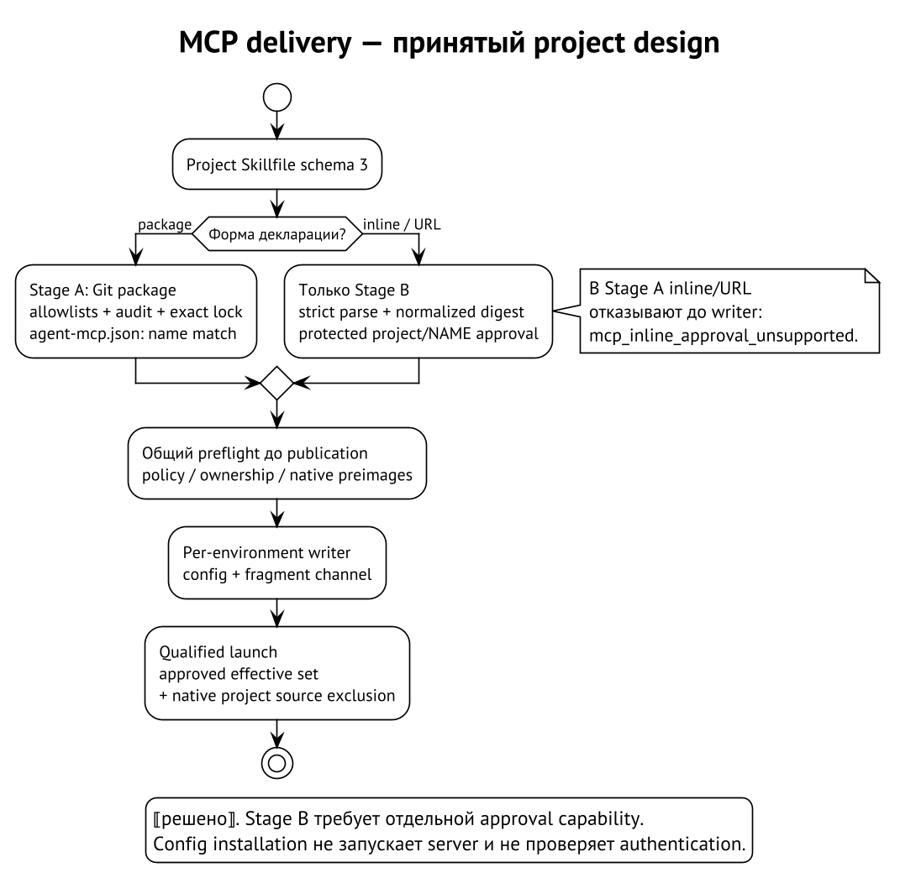

# MCP: от зависимости до native configuration

MCP связывает harness с сервером инструментов. Сервер по `stdio` — отдельный
процесс; HTTP endpoint — удалённая сторона, которой harness посылает запросы.
В обоих случаях запись в конфигурации влияет на доступные действия агента.
Поэтому «проекту нужен сервер» и «этому запуску разрешён сервер» — разные
утверждения.

## Требование skill и пакет контекста

У skill может быть MCP requirement: имя сервера и условия присутствия
в targets. Текущий checker читает известные native configuration files
и сообщает missing requirement либо предупреждение. Он не устанавливает
сервер, не исполняет его command и не проверяет authentication. Совпадение
имени не удостоверяет binary, endpoint или права учётной записи.
⟦работает сегодня⟧

Например, skill требует `docs` в Claude. Наличие `docs` в `.mcp.json`
может удовлетворить проверку присутствия; project-only server при этом
получает предупреждение о native trust gate. Отсюда ещё не следует,
что строгий managed launch допустит этот server. Read-only requirement
check и admission имеют разные контракты. ⟦работает сегодня⟧

Для profile context сервер описывается отдельным Git package с
`agent-mcp.json`. Context package ссылается на него через requirements;
resolution включает пакет в общий lock и audit. Декларация содержит
transport, command/args либо HTTPS URL, список допустимых environment IDs
и требуемые имена env. Значения секретов в пакет не кладутся.
⟦работает сегодня⟧

`stdio` command — имя executable для launch PATH, а не путь или shell
recipe. HTTP declaration использует HTTPS без userinfo, query и fragment.
MCP package allowlist ограничивает источники пакетов дополнительно
к source policy. Под permissive пустая allowlist предупреждает и допускает
все источники; под hardened наличие MCP dependency при пустом списке
приводит к отказу. Это разные явно обозначенные postures.
⟦работает сегодня⟧

## От lock к каналу harness

Curator сортирует применимые серверы и материализует native-shaped файл.
Launch fragment сообщает его путь, channel и union `env_names`. В файле
описывается сервер; значения разрешённых переменных приходят из launch
окружения по отдельной policy. Resolution не запускает сервер для
«проверки готовности». ⟦работает сегодня⟧

| Environment | Файл относительно managed home | Channel | Ограничение |
| --- | --- | --- | --- |
| `claude_code` | `.agent-context/mcp/claude_code.json` | `--mcp-config` и `--strict-mcp-config` | Strict channel исключает остальные MCP configs; это не выключатель instructions или hooks |
| `codex_cli` | `curator-mcp.config.toml` | `-p curator-mcp` | Layering поверх base; чистота базы зависит от seed revision, project discovery требует отдельного контроля |
| `opencode` | `.agent-context/mcp/opencode.json` | `OPENCODE_CONFIG` | Native merge может дать project config более высокий приоритет; это recorded residual |
| `pi` | Нет | Нет | Встроенный MCP channel отсутствует; extension требует отдельного контракта |
| `muse` | Нет | Нет в текущем adapter | Позднее исследование native `.mcp.json` не добавляет writer в код Curator |

У Codex второй `-p` не означает безопасное добавление ещё одного профиля,
а отсутствие layer file может быть проигнорировано runtime. Launch contract
поэтому требует проверки файла непосредственно перед exec. У OpenCode
успешная запись собственного файла не доказывает, что project server
с тем же именем не победит при merge. Таблица отражает код materializer
и registry; native enforcement и его versions требуют своей проверки.
⟦работает сегодня⟧

Пустой набор в текущем materializer не создаёт MCP file и section fragment.
Это нельзя выдавать за принятый strict контракт «доставлен явно пустой
набор и запрещён любой другой источник». Для строгого project-aware
запуска требуется именно enforceable effective set, иначе отказ.
⟦решено⟧

## Проектный Skillfile: два этапа

Принятый следующий формат — project Skillfile schema 3: schema 2 плюс
необязательная map `mcp_servers`. Это не версия skill manifest. Глобальный
Skillfile schema 3 не получает; schemas 1/2 не начинают молча принимать
новое поле. Существующие releases через rc.7 требуют upgrade вместо
частичного разбора такого файла. ⟦решено⟧

У декларации три формы: URL shorthand, inline `server` или `package`.
Первые две дают сервер прямо в проекте; третья ссылается на Git package.
Ниже показан будущий package-only вариант, а не готовый input для
текущего installer. Адрес зарезервирован для примера. ⟦решено⟧

```json
{
  "schema_version": 3,
  "skills": [],
  "mcp_servers": {
    "docs": {
      "package": {
        "git": "https://code.example.invalid/tools/docs.git",
        "tag": "v1.2.3",
        "directory": "mcp/docs"
      }
    }
  }
}
```

**Stage A** сначала принимает только declaration packages. Selector — ровно
один из `range`, `tag`, `revision`; `branch`, local snapshot и source alias
не добавляются. Полный commit фиксируется в будущем versioned lock;
`agent-mcp.json` в выбранном каталоге обязан иметь то же имя `docs`.
Source/MCP allowlists, signer/revocation и audit остаются обязательными.
URL и inline arm распознаются, но отказывают с
`mcp_inline_approval_unsupported`. ⟦решено⟧

**Stage B** включает inline через project admission. Для него защищённый
ключ одобрения — registered project identity и case-sensitive server NAME.
Одобрение связано с digest normalized SERVER, approver и effective ceiling.
Даже простая HTTPS строка требует отдельного одобрения: удалённая сторона
тоже получает полномочия. File `approval.json` внутри checkout не создаёт
такую запись. ⟦решено⟧



## Что именно связывает digest

**Server digest** вычисляется после strict parse и semantic validation.
Shorthand расширяется в объект, отсутствующий `env_names` становится `[]`,
имена env и явные environments сортируются. Порядок args и значения строк
сохраняются. CCJ-1 задаёт canonical object bytes; SHA-256 связывает именно
их, без presentation newline. ⟦решено⟧

Например, URL shorthand и его точное раскрытие дают одинаковый server
digest. Перестановка JSON keys тоже его не меняет. Перестановка двух args,
другой endpoint, список env names или environments требуют нового approval.
Переименование `docs` в `docs-next` не переносит approval, даже если digest
сервера совпал: NAME связан отдельно. ⟦решено⟧

**Declaration digest** дополнительно учитывает форму декларации и
writer-local `install`; effective plan связывает resolved package identity.
Raw manifest digest продолжает связывать исходный manifest и не заменяется
нормализованным MCP hash. Иначе перенос authority между синтаксически
разными carriers стал бы незаметен. ⟦решено⟧

`install` — место для writer-local options, а не стандартный набор
`headers`, `auth`, `scope` и `git_policy`. Их grammar здесь не установлен.
Writer должен назвать каждый option и сообщить, применён он или
проигнорирован. Option не может отменить audit, расширить secret access
или изменить SERVER; влияющая на control configuration поддержка требует
собственного approval binding. ⟦решено⟧

Начальный writer должен игнорировать все OPTIONS и явно перечислять
проигнорированные опции в plan, не раскрывая потенциально секретные
значения. Поддержка typed headers/auth требует отдельного контракта и
approval эффективной конфигурации. Пример возможного header не означает,
что такая опция уже доступна. ⟦решено⟧

## Runtime pins и отказ без частичной записи

Git commit фиксирует декларацию, но команда вида `npx tool@latest` может
получить другое executable содержимое завтра. Даже `tool@1.2.3` в примере
не доказывает, что parser закрывает все package-manager обходы. Требуется
общая закрытая grammar pinning для `npx`/`uvx` и отрицательные vectors;
её окончательное принятие остаётся открытым. Пока нет validator, нельзя
называть произвольную runtime command воспроизводимой. ⟦открыто⟧

Весь набор деклараций, approvals, current policy и native preimages
проверяется до publication. Foreign same-name server — conflict, не
разрешение на overwrite. Отказ должен сохранить прежние native files,
lock, skills и ownership records. При update новый digest не становится
approved автоматически. ⟦решено⟧

Report содержит outcome для каждой определимой пары NAME/environment.
Известный adapter без writer получает `skipped: unsupported`, а не
придуманный путь. Такой install skip не разрешает managed launch,
если ему нужен этот MCP capability. Dry run не fetch-ит отсутствующие
locked inputs, не проверяет login и не начинает server. После записи
конфигурации authentication остаётся непроверенной. ⟦решено⟧

Допуск MCP — цепочка независимых проверок: источник, содержимое,
полномочия, writer и native exclusion. Сервер, прошедший audit, всё равно
может возвращать ошибочные данные. Credentials и доступные ему операции
остаются отдельной границей из следующей главы.
