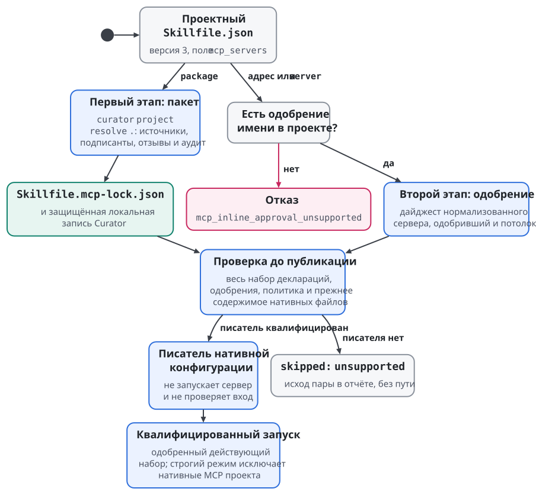

# MCP: от зависимости до нативной конфигурации

MCP связывает харнес с сервером инструментов. Сервер с транспортом `stdio` работает отдельным процессом, который харнес запускает сам. Сервер с транспортом HTTP представляет собой удалённую сторону, которой харнес посылает запросы. В обоих случаях одна запись в конфигурации харнеса меняет набор действий, доступных агенту. Поэтому "проекту нужен сервер" и "этому запуску разрешён сервер" остаются разными утверждениями.

Curator различает четыре вещи: требование скилла, пакет объявления сервера, запись в нативной конфигурации харнеса и доступность самого сервиса. Каждая следующая ступень требует своей проверки, и ни одна ступень не следует из предыдущей сама.

## Требование скилла

Скилл объявляет нужные ему серверы в манифесте, в поле `dependencies.mcp_servers` (манифест скилла версии 5). Ключом служит имя сервера, значение содержит обязательную подсказку `hint` о способе подключения, необязательный транспорт `transport` (`stdio` или `http`) и условие `required_in`. При `any` (по умолчанию) серверу достаточно быть настроенным хотя бы в одной целевой среде, при `all` он нужен в каждой.

При установке Curator проверяет требование чтением известных нативных файлов конфигурации. В проекте он читает `.mcp.json` для Claude Code, `.codex/config.toml` для Codex и `opencode.json` для OpenCode, в домашнем каталоге пользователя читает `.claude.json`, `.codex/config.toml` и конфигурацию OpenCode; для других поддерживаемых агентов он читает их собственные файлы. Сервер, выключенный в `disabledMcpjsonServers` настроек Claude, Curator считает ненастроенным. Невыполненное требование останавливает установку и печатает подсказку из `hint`. Сервер с транспортом `stdio`, команды которого нет в `PATH`, даёт предупреждение. Сервер, настроенный только в файле проекта, даёт предупреждение о том, что харнес держит такие серверы в ожидании до доверия к чекауту.

Проверка только читает. Curator не устанавливает сервер, не исполняет его команду и не проверяет вход. Совпадение имени не удостоверяет исполняемый файл, адрес сервера или права учётной записи, поэтому результат формулируется буквально: сервер настроен по имени.

Например, скилл требует `docs` в Claude, и в `.mcp.json` проекта есть запись `docs`. Проверка присутствия проходит, а установка печатает предупреждение о том, что сервер есть только в проекте. Отсюда не следует, что строгий управляемый запуск допустит этот сервер: проверка требования и допуск в запуск подчиняются разным контрактам.

## Пакет объявления сервера

Для профиля сервер описывает отдельный git-пакет с файлом `agent-mcp.json`. Контекстный пакет профиля ссылается на него в `requires.mcp` полями `git`, ровно одним из `range`, `tag` или `revision` и необязательным `directory`. Разрешение профиля включает пакет сервера в общий lock и в аудит, как любой другой пакет.

Объявление называет транспорт, команду с аргументами или адрес, допустимые агентские среды и имена нужных переменных окружения:

```json
{
  "schema_version": 1,
  "name": "docs",
  "version": "1.2.3",
  "server": {
    "transport": "stdio",
    "command": "docs-mcp",
    "args": ["--read-only"],
    "env_names": ["DOCS_TOKEN"],
    "environments": ["claude_code", "codex_cli"]
  }
}
```

Объявление содержит имя `DOCS_TOKEN`, а значение переменной в пакет не попадает. Команда `stdio` представляет собой голое имя исполняемого файла, которое харнес ищет в `PATH` запуска; путь и строка для shell в ней недопустимы. Адрес HTTP-сервера использует схему HTTPS без учётных данных, параметров запроса и фрагмента. Имена переменных не могут совпадать с зарезервированными менеджером: `PATH`, `HOME`, переменными XDG и прокси, а также семействами `LD_*`, `DYLD_*`, `PYTHON*`, `NODE_*` и `NPM_CONFIG_*`.

Список разрешённых MCP-пакетов `environments.mcp_package_allowlist` в машинной конфигурации ограничивает источники пакетов дополнительно к общему списку источников. В разрешительном режиме безопасности (`permissive`) Curator предупреждает о самом режиме, а пустой список допускает любой источник. В строгом режиме (`hardened`) профиль с MCP-объявлением при пустом списке получает отказ `mcp_package_allowlist_empty`, а профиль без объявлений получает только предупреждение.

## От lock к каналу харнеса

При разрешении профиля Curator выбирает объявления, применимые к среде, сортирует их по имени и материализует один файл нативной формы в управляемом доме. Fragment сообщает путь файла, канал харнеса и объединение имён `env_names` (глава "Агентские среды и харнесы"). Файл описывает серверы, а значения переменных приходят из окружения запуска по отдельной политике. Разрешение профиля сервер не запускает, даже для проверки готовности.

| Агентская среда | Файл в управляемом доме | Канал харнеса | Предел |
| --- | --- | --- | --- |
| `claude_code` | `.agent-context/mcp/claude_code.json` | `--mcp-config` вместе с `--strict-mcp-config` | Строгий канал исключает остальные источники MCP; инструкции и хуки он не выключает. |
| `codex_cli` | `curator-mcp.config.toml` | `-p curator-mcp` | Слой ложится поверх базового `config.toml`; конфигурация проекта требует отдельного контроля. |
| `opencode` | `.agent-context/mcp/opencode.json` | переменная `OPENCODE_CONFIG` | При слиянии конфигурация проекта стоит выше этого файла. |
| `pi` | нет | нет | Встроенного канала MCP у pi нет; расширение потребовало бы отдельного контракта. |
| `muse` | нет | нет | Fragment Muse не несёт канала MCP. |

У Codex флаг `-p` выбирает один слой профиля, и отсутствующий файл слоя Codex молча пропускает. Поэтому лаунчер проверяет файл слоя заново при каждом запуске и отказывает с кодом `mcp_layer_missing` или `mcp_layer_unreadable`, а собственный `-p` в нативных аргументах отклоняет с кодом `plan_refused` как конфликт с каналом MCP. Чистота базового `config.toml` зависит от правила создания дома: новый дом Codex получает базу без таблиц `mcp_servers` и `projects`, а дом, созданный по старому правилу, сохраняет прежнюю базу с диагностикой `mcp_seed_unstripped`. У OpenCode успешная запись собственного файла не доказывает, что сервер проекта с тем же именем не победит при слиянии. Лаунчер `curator-run` среду `opencode` не запускает (глава "Запуски и жизнь сессии").

Пустой набор не создаёт ни файла MCP, ни секции MCP во fragment. Значит, у Claude в таком запуске нет и `--strict-mcp-config`, и другие источники MCP остаются в силе. Строгому запуску с контекстом проекта нужен проверяемый действующий набор, и пустой набор в нём записывается явно (раздел "MCP в запуске с контекстом проекта").

## Запись в нативный файл по одной записи

Команда `curator profile mcp` ставит серверы из lock профиля в нативные файлы управляемого дома по одной записи, не переписывая файл целиком:

```sh
curator profile mcp status example
curator profile mcp install example --env claude_code,codex_cli --dry-run
curator profile mcp install example --env claude_code,codex_cli
curator profile mcp repair example --env claude_code
```

Ответ приходит в JSON и привязан к профилю и точному дайджесту его lock. На каждую определимую пару "имя и среда" приходится одна строка, а состояния пробного прогона начинаются с `would:`. Успешная публикация печатает ровно `MCP configuration installed. Authentication not checked.`

Писатель ставит только отсутствующие записи и только из lock профиля; серверы проекта он в общий дом профиля не ставит. Владение каждой записью он хранит в частном пространстве менеджера `mcp-native-v1/ownership/`, отдельно от нативного файла; одно зарезервированное имя файла владения не даёт. Чужая запись с тем же именем даёт конфликт, даже если её байты совпадают с нужными. Записи, изменённые вручную, писатель оставляет как есть и сообщает о расхождении. Восстановление, замена, удаление и перехват чужой записи отказывают с кодом `mcp_native_writer_authority_unavailable`: их право выдаёт отдельный подписанный акт оператора, и ни флаг, ни файл репозитория, ни одобрение проекта его не заменяют. У Codex писатель читает живой базовый `config.toml`, и запись базы с тем же именем тоже даёт конфликт.

Писатель квалифицирован для транспорта `stdio` на конкретных сборках Claude Code и Codex и конкретной платформе. Квалификация опознаёт сборку по дайджесту исполняемого файла и сам файл не запускает. HTTP, другие сборки и другие платформы отказывают с кодом `mcp_contribution_policy_refused` и причиной `native_writer_unqualified`. Для Muse сертифицированного нативного файла нет, и обязательная запись отказывает. Квалификация писателя относится только к нативному файлу: управляемый запуск, исключение нативных источников, перезагрузку конфигурации, возобновление, дочерних агентов и вход она не покрывает.

## Проектный Skillfile: два этапа

Проект объявляет серверы в своём `Skillfile.json` версии 3: это версия 2 с необязательным полем `mcp_servers`. Версия относится к проектному Skillfile; машинный глобальный Skillfile остаётся версии 1. Версии 1 и 2 нового поля не принимают, и инструмент, который знает только их, отвечает на версию 3 отказом с просьбой обновиться. Ни одна команда не поднимает версию файла сама.

Поле `mcp_servers` отображает имя сервера с учётом регистра ровно в одну декларацию. Декларация бывает строкой с адресом, объектом `server` прямо в проекте или ссылкой `package` на git-пакет. Ссылка на пакет выглядит так (адрес зарезервирован для примеров):

```json
{
  "schema_version": 3,
  "skills": [],
  "mcp_servers": {
    "docs": {
      "package": {
        "git": "https://code.example.invalid/tools/docs.git",
        "tag": "v1.2.3",
        "directory": "mcp/docs"
      }
    }
  }
}
```

**Первый этап** принимает только ссылки на пакеты. Селектор называет ровно одно из `range`, `tag` и `revision`; ветки, локального снимка и псевдонима источника у него нет. Файл `agent-mcp.json` в выбранном каталоге обязан носить то же имя `docs`. Команда `curator project resolve .` (или `refresh`) проверяет пакеты через список источников, список MCP-пакетов, политику подписантов, отзывы и строгий аудит и публикует рядом с неизменным lock источников файл `Skillfile.mcp-lock.json`. Сам файл lock из репозитория установку не разрешает: Curator хранит рядом защищённую локальную запись о том, что он сам разрешил.

`curator install . --dry-run` и проверка состояния работают только по зафиксированным локальным входам. Они ничего не скачивают, не входят в сервис и не запускают сервер, а отсутствующий вход дают отказом. Настоящая установка может восстановить отсутствующий снимок пакета на точном зафиксированном коммите под текущей политикой машины и при этом ни один селектор заново не разрешает. Пара "имя и среда", для которой у Curator нет квалифицированного писателя, получает исход `skipped: unsupported` без пути. Строку с адресом и объект `server` первый этап разбирает и проверяет, а затем отклоняет с кодом `mcp_inline_approval_unsupported`, в том числе когда декларация утверждает, что одобрена.

**Второй этап** допускает декларации прямо в проекте через допуск контекста проекта (CIP-0002). Ключ одобрения состоит из зарегистрированной менеджером идентичности проекта и имени сервера с учётом регистра. Одобрение связано с дайджестом нормализованного объекта `server`, с одобрившим и с действующим потолком полномочий. Простая строка с адресом HTTPS тоже требует одобрения, потому что удалённая сторона получает данные и полномочия агента. Файл одобрения внутри чекаута такой записи не создаёт: записи одобрения хранит защищённое состояние менеджера.

{.tall}

## Что связывает дайджест

**Дайджест сервера** Curator вычисляет после строгого разбора и смысловой проверки. Строка с адресом раскрывается в объект с транспортом `http`, отсутствующий `env_names` становится `[]`, имена переменных и явный список сред сортируются. Порядок аргументов и значения строк сохраняются без изменений: адреса не приводятся к нижнему регистру, аргументы не обрезаются, пути к командам не разрешаются. Каноническую запись JSON задаёт CCJ-1, и дайджест равен `sha256:` и SHA-256 этих байтов без завершающего перевода строки.

Например, строка с адресом и её точное раскрытие дают один дайджест сервера. Перестановка ключей объекта его тоже не меняет. Перестановка двух аргументов, другой адрес, другой список имён переменных или сред дают новый дайджест и требуют нового одобрения. Переименование `docs` в `docs-next` одобрение не переносит, даже если дайджест сервера совпал, потому что имя связано отдельно.

**Дайджест декларации** покрывает раскрытую декларацию целиком: нормализованный сервер или селектор пакета и поле `install`, где отсутствующее `install` записано как `{}`. Для пакета план дополнительно связывает точную полученную идентичность пакета и дайджест его сервера. Дайджест исходного манифеста по-прежнему связывает байты разобранного `Skillfile.json` и нормализованным хэшем MCP не заменяется. Иначе перенос полномочий между синтаксически разными файлами прошёл бы незаметно.

`install` содержит параметры, которые понимает конкретный писатель. Стандартного набора у них нет: `headers`, `auth`, `scope` и `git_policy` названы в контракте только как возможные применения, и их грамматика не задана. План называет каждый переданный параметр и сообщает, применён он или пропущен, не раскрывая значений. Параметр не может отменить аудит, расширить доступ к секретам или изменить объект `server`. Параметр, который меняет действующую конфигурацию, требует собственной привязки одобрения. Curator сохраняет все параметры в идентичности декларации, пропускает каждый и перечисляет их имена в отчёте.

## Закрепление команды

Git-коммит закрепляет декларацию, но команда `npx tool@latest` завтра может получить другой исполняемый код. Поэтому первый этап требует для `npx` и `uvx` точной версии. Для `npx` первый аргумент после необязательного `-y` или `--yes` имеет вид `имя@x.y.z` или `@область/имя@x.y.z`. Для `uvx` первый аргумент имеет вид `имя@x.y.z`, либо команда имеет форму `uvx --from имя==x.y.z команда`. Написание `NPX` или `npx.cmd` отклоняется, чтобы проверку нельзя было обойти другим именем той же программы.

Точная версия закрепляет имя выпуска в реестре пакетов. Байты пакета Curator не скачивает и не хэширует, так что запуск получает то, что реестр отдаёт под этой версией. Произвольная команда, кроме `npx` и `uvx`, проходит проверку пина без ограничений и воспроизводимой от этого не становится.

## Отказ без частичной записи

Curator проверяет весь набор деклараций, одобрения, текущую политику и прежнее содержимое нативных файлов до любой публикации. Чужой сервер с тем же именем даёт конфликт и права на перезапись не даёт. Отказ сохраняет прежние нативные файлы, lock, скиллы и записи о владении и одобрении. При обновлении новый дайджест одобренным автоматически не становится.

Отчёт содержит один исход для каждой определимой пары "имя и среда" в постоянном порядке, с канонической средой и настоящим путём файла. Исходы такие: `added`, `updated`, `unchanged`, `restored`, `removed`, `released`, `skipped: drift`, `skipped: unsupported`, `conflict: foreign entry` и `refused: <код>`. Для среды без писателя путь равен `unavailable`, и Curator его не придумывает. Пропуск `skipped: unsupported` отказом не считается, но и управляемый запуск, которому нужен этот сервер, он не разрешает. Отказанная операция всё равно перечисляет все определимые пары и итог отказа, без единого успешного исхода. Синтаксическая ошибка, из-за которой пары не перечислить, даёт диагностику на уровне декларации.

Пробный прогон только читает: он не скачивает отсутствующие зафиксированные входы, не проверяет вход и не запускает сервер. После записи конфигурации вход в сервис остаётся непроверенным. Сервер, прошедший аудит, всё равно может вернуть ошибочные данные: аудит относится к декларации и пакету, а учётные данные и доступные серверу операции составляют отдельную границу (глава "Безопасность, разрешения и доверие").

## MCP в запуске с контекстом проекта

В запуске с допущенным контекстом проекта действующий набор серверов складывается из одобренных серверов профиля и проекта (глава "Контекст проекта и рабочее место"). Серверы с одним идентификатором и одинаковым нормализованным определением сливаются в один. Разные определения под одним идентификатором требуют явного одобрения замены, без него композиция отказывает. Пустой набор означает явно применённый пустой набор.

Адаптер Claude для проекта записывает действующий набор в `.agent-context/mcp/claude_code.json`, а пустой набор записывает явно как `{"mcpServers":{}}`. Запуск передаёт этот файл вместе с `--strict-mcp-config`, поэтому `.mcp.json` репозитория в набор не попадает. Настройки управляемого дома запрещают вызовы инструментов `mcp__*`: харнес подключается к одобренным серверам, а вызов их инструментов требует гранта менеджера. Имена разрешений MCP и произвольные выражения разрешений из проекта в настройки не попадают.

Адаптер Codex для проекта заменяет таблицу `mcp_servers` в управляемом `config.toml` действующим набором, включая явно пустой. Нативное слияние Codex при этом сохраняет политику MCP из конфигурации репозитория. Например, `disabled_tools` в `.codex/config.toml` проекта убирает инструмент из каталога сервера вопреки полным аргументам менеджера. Поэтому адаптер Codex отказывает в запуске по разрешениям с кодом `project_context_unsupported`. Обязательный MCP-сервер для Muse отказывает с кодом `mcp_contribution_policy_refused`, потому что у Muse нет сертифицированного нативного файла MCP.
