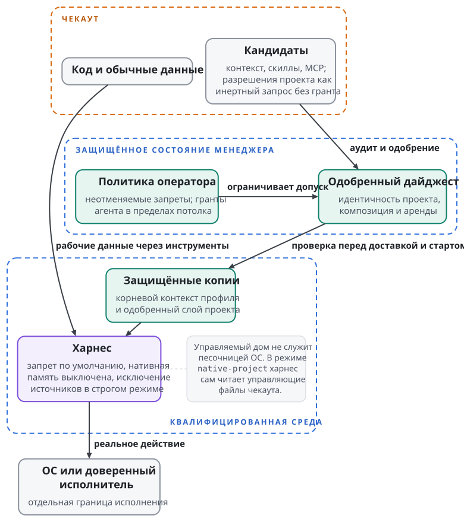

# Безопасность, разрешения и доверие

Curator управляет происхождением и доставкой контекста. Угроза возникает, когда вход более слабой стороны становится полномочием более сильной. Чекаут выбирает инструмент, текст скилла запускает команду, старое одобрение разрешает новые байты, соседний процесс подменяет файл после проверки. Каждую такую границу Curator проверяет отдельно.

**Доверием** в этой книге называется разрешённый способ использовать конкретный вход. Доверие к источнику Git не распространяется на каждую его будущую версию. Допуск инструкции не разрешает сетевой MCP-сервер. Нативное доверие харнеса к рабочему каталогу не заменяет одобрения менеджером отдельных элементов проекта.

## Где находятся полномочия

Репозиторий проекта содержит рабочие данные. Управляющие элементы проекта приходят в харнес защищёнными копиями после одобрения, а полномочия хранит состояние менеджера. Корневой контекст профиля стоит первым, одобренный слой проекта добавляется после него в записанном порядке (глава "Слои контекста"). Изменение чекаута не меняет одобренного поколения: новое содержимое снова проходит допуск.

Кто читает управляющие файлы репозитория, решает режим источников. Оператор выбирает его для каждой тройки "чекаут × профиль × агентская среда" (глава "Контекст проекта и рабочее место"). В строгом режиме (`strict`) адаптер подавляет нативное обнаружение неодобренных инструкций, настроек, разрешений, скиллов, MCP, хуков, плагинов и памяти, и харнес получает только одобренные копии. В режиме `native-project` харнес читает файлы репозитория по своим правилам, а Curator доставляет из проекта только одобренные целые скиллы и одобренные MCP. Управляемый документ инструкций в этом режиме содержит один корневой контекст профиля, а статус и запуск сообщают дословно `project sources not isolated`. Строгий режим без квалифицированного исключения нативных источников отказывает и в режим `native-project` сам не переходит.

{.tall}

## Запрет по умолчанию

Разрешения харнеса программирует менеджер, и его политика начинается с запрета по умолчанию (default deny). Менеджер собирает её для каждой агентской среды из политики оператора и неотменяемых запретов машины. Правило одинаково для строгого режима и режима `native-project`. Агент может запросить изменение, но применяет его только через защищённый грант в пределах заранее выданного потолка. Одобрение оператором отдельного элемента тоже не отменяет неотменяемого запрета. Адаптер, который не может обеспечить эту политику на реальном харнесе, отказывает в запуске с кодом `project_context_unsupported`.

**Грант** связывает разрешённое действие с участником и потолком полномочий. Разрешение агенту одобрять знакомые текстовые инструкции не даёт ему права добавить сетевой MCP-сервер. Включённая категория `mcp` открывает рассмотрение кандидатов и не одобряет ни одного элемента. Менеджер сверяет действующие гранты и отзыв при подготовке, при старте и при вызове команды.

Байты разрешений, которые поставляет проект, **никогда не применяются**, даже если они строже текущей политики. Curator выводит их как инертный запрос для отдельного гранта менеджера. Иначе у проекта появился бы второй язык управления политикой, а смешение правил allow и deny с нативным порядком приоритетов могло бы изменить реальный смысл ограничения. `curator project inspect` перечисляет кандидатов проекта и не импортирует ни разрешений, ни памяти.

Политику проверяют по реальному действию харнеса. Например, Codex 0.162.1 объединяет аргумент менеджера `-c mcp_servers={}` с серверами из конфигурации репозитория. Настройка `disabled_tools` из репозитория после этого убирает инструмент из реального каталога MCP, хотя аргументы менеджера полны. Политика менеджера здесь перестаёт быть единственным источником разрешений, поэтому адаптер Codex в режиме `native-project` отказывает по поверхности разрешений.

## Режим разрешений во fragment

Fragment, который выдаёт `curator env resolve` (глава "Агентские среды и харнесы"), несёт объект `permissions` с полями `mode`, `locked` и `source`. Поле `mode` принимает значения `native` и `yolo`. Без настройки профиля менеджер выбирает `native` с источником `default`, а настройка в карте `environments.permissions` даёт источник `profile`. Системная конфигурация машины может заблокировать `environments.permissions`, и тогда каждый профиль получает такой объект:

```json
"permissions": {"mode": "native", "locked": true, "source": "global"}
```

Блокировка действует и для профиля, которого нет в карте. Значения разрешает код менеджера из конфигурации машины, и текст инструкций проекта на них не влияет. `curator env config show permissions` печатает действующие значения.

Значение `native` означает собственный режим разрешений харнеса. Исполнения политики с запретом по умолчанию оно не доказывает, и `yolo` тоже не даёт права эту политику обойти. Поэтому лаунчер, который знает только два этих режима, не становится адаптером строгого режима. Для этого ему нужна возможность, которая обеспечивает политику менеджера на реальном харнесе.

## Память выключена отдельно

**Нативной памятью** называется изменяемое состояние, которое харнес сохраняет между сессиями. **Знаниями репозитория** называются выбранные материалы проекта, которые приходят как одобренный контекст. Одобрение справочника API не включает нативную автоматическую память.

Каждая композиция проекта несёт `memory: "off"`, и адаптер обязан выключить нативную память в обоих режимах источников. Каталог `memory/` в доме харнеса сам по себе ничего не выключает. Выключение подтверждает квалификация адаптера на старте, перезагрузке, возобновлении и входе дочернего процесса, и адаптер, который его не обеспечивает, отказывает с `project_context_unsupported`.

Частная память включается только явным согласием оператора в сертифицированной агентской среде. Она принадлежит состоянию рабочего места, отдельно от допуска репозитория, и хранится там до явного удаления. Её нельзя публиковать, переиспользовать в другом рабочем месте или превращать в знания репозитория.

## Аудит, сетевые декларации и белые списки

**Аудит** проверяет известные опасные свойства выбранного содержимого. `curator audit` и флаг `--audit` команд установки работают в режиме `advisory` или `strict` и учитывают идентичность пакета и хэш содержимого. Установка профиля проверяет каждый член профиля строгим аудитом. Детекторы ищут определённые шаблоны. Например, находка `audit.capability.network-undeclared` отмечает сетевое обращение в анализируемом скрипте, которое не покрывает ни одна запись `capabilities.network`. Анализа любого возможного исполнения аудит не даёт.

Белые списки Curator различаются по назначению. `allowed_sources` ограничивает канонические идентичности источников Git, `mcp_package_allowlist` ограничивает пакеты деклараций MCP, `passable_env_names` ограничивает имена переменных оператора, которые получает запуск MCP-сервера. Ни один список не заменяет другие.

Строгость этих проверок задаёт позиция безопасности машины `security_posture`. Позиция `hardened` действует по умолчанию для конфигурации машины со `schema_version: 2`, а конфигурация первой схемы сохраняет прежнее поведение `permissive`. Позиция `hardened` включает строгий аудит и политику реестра, отклоняет транзитивные системные модули без записанного исключения и требует ключей подписантов источников. Пустой `allowed_sources` в этой позиции отказывает установке и обновлению с `source_allowlist_empty`. Пустой `mcp_package_allowlist` отказывает установке и обновлению профиля с декларациями MCP с `mcp_package_allowlist_empty`. Явный `null` в `passable_env_names` отказывает как неограниченная передача. Позиция `permissive` сохраняет прежние умолчания и при каждой операции менеджера предупреждает `security_posture_permissive`. Поэтому конфигурации по умолчанию на разных машинах не одинаково жёсткие.

Объявление `network: ["api.example.invalid"]` в `capabilities` скилла сообщает намерение и даёт аудиту материал для сверки. Сетевого фильтра хоста оно не создаёт. Объявленные хосты остаются отчётом и для команды на принудительном пути, поэтому аудит предупреждает `script-command-unfiltered-declared-network`. Вычисленный во время работы адрес может уйти от статического детектора.

Команды через установленные шимы исполняются с правами ОС вызывающего пользователя. Команда-скрипт по умолчанию только объявлена, и аудит отмечает её `script-command-declared-only`. Явный выбор `execution_policy: "script-worker-v1"` включает отдельный принудительный переносимый путь с элементами управления менеджера. Скомпилированные сборки по умолчанию исполняются через `manager-worker-v1`. Ни один из этих переносимых путей не даёт ограничения силами ядра.

Явный `execution.mode: verified` требует отдельно установленного доверенного провайдера и его свидетельств. Без них этот путь отказывает и в переносимый режим не откатывается. Сообщение об отсутствии провайдера означает соблюдение границы, и убирать из-за него проверку нельзя.

## Одобрение и секреты

Хэш идентифицирует байты и согласия оператора не выражает. Защищённое одобрение связывает чекаут, элемент, его дайджест, агентскую среду, дайджест потолка политики и участника, который одобрил. `curator project approve` требует одновременно дайджест элемента и дайджест пакета на рассмотрение из `curator project preview`. Изменённое содержимое проходит упаковку и рассмотрение заново, и старое одобрение к нему не подходит. Файлы одобрения в репозитории и совпадающие хэши из другого чекаута полномочий не дают. Отзыв (`curator project revoke`) закрывает новые запуски и допуск вызовов команд. Замена файлов не отзывает контекста, который харнес уже загрузил, а возобновление сессии заново проверяет текущие полномочия (глава "Запуски и жизнь сессии").

Секреты не попадают в инструкции, аргументы пакетов и URL. Декларация MCP называет переменные через `env_names`, и менеджер передаёт запуску значение только для имени из `passable_env_names`. Значений нет ни в пакете, ни в lock, ни в маркере, ни во fragment, ни в материализованных файлах.

Детектор секретного материала проверяет строки декларации MCP в `Skillfile.json`: URL и аргументы сервера и параметры `install`. Находка отклоняет декларацию с классом `context-secret-material`. Сообщение называет поле и не повторяет байтов секрета. Ни одобрение, ни обычный пин содержимого такую находку не снимают.

Допуск проекта отдельно отклоняет известные файлы входа харнесов: `auth.json`, `.credentials.json` и `config/muse/auth.json`, включая их варианты регистра. Кандидат с таким файлом отклоняется целиком до публикации снимка, даже если он необязателен или файл пуст. Эта граница работает по именам файлов и общим поиском секретов не служит.

Учётные данные управляемого дома подчиняются режиму логина `shared` или `isolated` (глава "Управляемый дом"). Ни один режим не копирует секретов в lock профиля, и ни один не изолирует учётную запись у провайдера. Если харнес сам переписывает файл учётных данных, свойства этой записи устанавливает измерение адаптера. Смена переменной дома не делает неизвестный цикл обновления проверенным.

## Подписи релизов

Подпись отвечает, какой ключ подписал объект. Lock отвечает, какой объект выбран. Аудит отвечает на вопрос об известных свойствах объекта. Эти проверки дополняют друг друга, и ни одна не доказывает правильности будущего поведения модели или отсутствия ошибок в программе.

Для проверки тегов релизов репозиторий Curator публикует файл `RELEASE_SIGNERS` в формате `allowed_signers` git. Файл различает ключи подписи релизов и исторический ключ подписи коммитов, которым подписан один ранний тег-кандидат. Файл лежит в самом проверяемом репозитории, поэтому ключ закрепляют по независимому доверенному каналу. Ключ из проверяемого объекта набор подписантов не расширяет. Тег проверяет такая команда, и содержимого релиза она не исполняет:

```sh
git -c gpg.ssh.allowedSignersFile=RELEASE_SIGNERS verify-tag <release-tag>
```

Скачанный исполняемый файл проверяется отдельно. Установщик `install.sh` для macOS и Linux сначала проверяет `checksums.txt` через аттестацию артефакта GitHub (`gh attestation verify`). Без GitHub CLI он проверяет подпись `checksums.txt.sig` и сертификат `checksums.txt.pem` через cosign. Оба пути закрепляют подписанта за workflow `release.yml` репозитория Curator на тегах `v*` и издателя за `https://token.actions.githubusercontent.com`. Затем установщик сверяет SHA-256 архива с `checksums.txt`. Отсутствие инструментов проверки, неверная аттестация или подпись, чужой подписант или издатель и несовпадение контрольной суммы запрещают установку. Подписанный тег Git сам по себе скачанного архива не удостоверяет.

Аварийная переменная `CURATOR_INSTALL_INSECURE_SKIP_VERIFY=1` отключает все проверки установщика, и он печатает предупреждение. Так оператор видимо обходит проверку целостности, и результат такой установки проверенной поставкой не считается.

## Что остаётся за границей

Curator объясняет происхождение контекста и контролирует его материализацию. Сильную границу исполнения дают подходящий харнес, провайдер и операционная система. Для каждой угрозы Curator называет свою защиту и остаток, который требует другой границы:

| Угроза | Защита Curator | Остаток |
| --- | --- | --- |
| Чекаут подсовывает инструкции или инструмент | Одобренные копии, исключение нативных источников в строгом режиме, политика менеджера с запретом по умолчанию | Защита действует только для квалифицированной связки среды, версии и платформы; в режиме `native-project` харнес читает репозиторий сам |
| Подвижная ссылка Git изменилась | Точный lock и проверенное полученное содержимое | Закреплённый код может содержать ошибку |
| Нечитаемый файл принят за отсутствующий | Типизированный отказ с сохранением прежнего состояния; например, `curator gc` не чистит рантаймы без доказанной полноты набора ссылок | Не каждая проверка нативной конфигурации на старых путях следует этому контракту |
| Соседний процесс того же пользователя ОС подменяет входы | Защищённое состояние, проверка владельца, чтение без перехода по ссылкам | Гонка между проверкой и использованием у того же пользователя и доступ к секретам требуют границы ОС |
| Хост пересобрал "почти тот же" процесс | Запечатанный точный план запуска и проверка на границе старта | Дайджест без авторизации не делает доверенным того, кто собрал план |
| Модель неверно поняла задачу | Явный и проверяемый состав контекста | Послушание модели и качество ответа не гарантируются |
