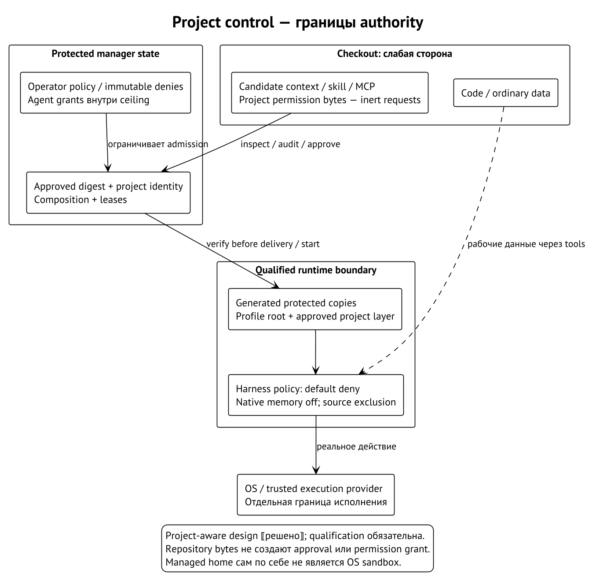

# Безопасность, permissions и trust

Curator управляет происхождением и доставкой контекста. Угроза возникает,
когда вход более слабой стороны становится полномочием более сильной:
checkout выбирает tool, текст skill запускает команду, старый approval
разрешает новые bytes, соседний процесс подменяет файл после проверки.
Полезно разбирать каждую такую границу отдельно.

**Trust** в этой книге — разрешённый способ использовать конкретный input.
Доверие Git source не означает доверия его каждой будущей версии.
Admission инструкции не разрешает network server. Native workspace trust
harness не заменяет manager approval отдельных project items.

## Где находятся полномочия

В принятой project-aware модели repository — рабочие данные. Управляющие
items приходят в harness как approved protected copies; authority хранится
в manager state. Profile root сохраняется, project layer добавляется после
него в установленном порядке. Изменение checkout не должно незаметно
менять approved generation. ⟦решено⟧



При strict запуске permission policy имеет **default deny**. Менеджер
программирует её для каждого harness с учётом immutable fleet/manager denies.
Агент может запросить изменение, но применяет его только через защищённый
grant в пределах заранее выданного ceiling. Оператор тоже не отменяет
immutable deny одним item approval. Если adapter не умеет обеспечить
policy, запуск отказывает. ⟦решено⟧

**Grant** связывает разрешённое действие с principal и ceiling. Разрешение
агенту одобрять знакомые текстовые instructions не даёт ему права добавить
network MCP server. Включённая категория `mcp` разрешает рассмотрение
кандидатов, но не утверждает каждый item. Принятый или отозванный grant
должен проверяться в соответствующей точке допуска. ⟦решено⟧

Project-shipped permission bytes **никогда не применяются**, даже если
они выглядят строже текущей policy. Их можно показать как inert request
в отдельном manager grant flow. Иначе проект получил бы второй язык
управления policy, а смешение allow/deny и native precedence могло бы
изменить реальный смысл ограничения. ⟦решено⟧

## Текущий transport permissions

Существующий fragment передаёт `native` или `yolo`, а также `locked`
и `source`. Без profile setting выбирается `native`; глобальный lock
принудительно выбирает `native` для всех профилей. Эти значения разрешаются
в manager code, а не извлекаются из project instruction text.
⟦работает сегодня⟧

`native` означает native permission mode harness. Он не доказывает
попрограммное default-deny исполнение принятого project-aware контракта.
И `yolo` в legacy transport не даёт права обойти этот контракт. Например,
старый launcher, умеющий два режима, нельзя объявить strict adapter
без capability, которая обеспечивает manager policy на реальном runtime.
⟦решено⟧

## Memory выключена отдельно

**Native memory** — изменяемое состояние, которое harness сохраняет между
сессиями. **Repository knowledge** — выбранные материалы проекта,
поступающие как одобренный context. Approval справочника API не является
согласием на native auto-memory. ⟦решено⟧

Для project-aware запуска native memory по умолчанию `off`. Private mode
требует явного opt-in и certified environment; private mutable data
принадлежит Werkstatt state, отдельно от repository admission. Первая
поставка откладывает private-memory delivery. Наличие native каталога
`memory/` у runtime само по себе не реализует эту policy. ⟦решено⟧

После явного opt-in private memory хранится отдельно в своей Werkstatt
до явного удаления. Её нельзя публиковать, переиспользовать между
Werkstätten или превращать в repository knowledge. Grammar opt-in delivery
и native qualification остаются последующей инженерной работой.
⟦решено⟧

## Audit, network declarations и allowlists

**Audit** проверяет известные опасные свойства выбранного содержимого.
Curator различает advisory и strict audit, учитывает package identity
и content hash. Детекторы ищут определённые patterns: например, network
contacts в анализируемых script files и несоответствие
`capabilities.network`. Это не универсальный анализ любого исполнения.
⟦работает сегодня⟧

Есть несколько списков с разными ролями. Source allowlist ограничивает
canonical Git identities. MCP package allowlist ограничивает declaration
packages. Passable env names ограничивают передачу переменных при launch.
Ни один список не заменяет остальные. В hardened posture пустая source
allowlist отказывает; permissive допускает более широкую политику с
явной диагностикой. Не следует называть любую default configuration
одинаково жёсткой. ⟦работает сегодня⟧

Объявление `network: ["api.example.invalid"]` сообщает намерение и даёт
материал для audit. Оно не создаёт host firewall. У portable enforced
script path есть manager-owned controls и ограничения платформы;
полный host-glob filter или kernel sandbox из одной декларации не
возникает. Произвольное вычисление адреса может выходить за возможности
статического detector. ⟦работает сегодня⟧

Команды через installed shims исполняются с OS privileges вызывающего
пользователя. Script commands по умолчанию declared-only; opt-in
`script-worker-v1` включает отдельный enforced portable path. Compiled
builds по умолчанию используют `manager-worker-v1`. Ни один из этих
portable путей не обещает полную kernel-enforced confinement.
⟦работает сегодня⟧

Явный `execution.mode: verified` требует отдельно установленного trusted
provider и evidence. Если их нет, путь отказывает вместо fallback
в portable. В рассматриваемой поставке Curator такой provider не
поставляется. Ошибка о его отсутствии — ожидаемое соблюдение границы,
а не повод убрать проверку. ⟦работает сегодня⟧

## Approval и секреты

Hash идентифицирует bytes; он не выражает согласия оператора. Protected
approval связывает project, item, digest, environment и ceiling.
При изменении content старое одобрение не подходит. При revocation
будущая admission прекращается; lifecycle уже работающей сессии требует
своего установленного правила. ⟦решено⟧

Секреты не должны попадать в instructions, package args или URL. Env
references передают имена, а значения разрешаются отдельно. В новом
MCP admission detector проверяет также inline args, URL и install input;
ordinary approval не снимает secret finding. Diagnostic должен назвать
field/class без повторения secret bytes. ⟦решено⟧

Managed home может использовать native credential link либо ambient
credential store по правилам adapter. Это не копия секретов в profile
lock и не обещание account isolation. Если runtime обновляет credential
file, нужны измерения его write pattern. Смена home variable не
превращает неизвестный refresh lifecycle в проверенный.

## Подписи и release signers

Подпись отвечает на вопрос, какой ключ подписал объект. Lock отвечает,
какой объект выбран. Audit отвечает на известные свойства объекта.
Эти проверки дополняют друг друга, но ни одна не доказывает правильность
будущего поведения модели или безошибочность программы.

Для проверки release tags репозиторий публикует `RELEASE_SIGNERS`.
Он различает release key и исторический ключ подписи commits; доверенный
набор нельзя расширять любым ключом из самого проверяемого объекта.
Ключ следует закреплять через независимый доверенный канал. Сама команда
проверки tag не выполняет содержимое релиза. ⟦работает сегодня⟧

```sh
git -c gpg.ssh.allowedSignersFile=RELEASE_SIGNERS verify-tag <release-tag>
```

Для скачанного binary нужна отдельная проверка distribution. Installer
macOS/Linux сначала проверяет `checksums.txt` через GitHub attestation
либо cosign, закрепляя workflow identity и issuer, затем сверяет SHA-256
архива. Missing tools, invalid signature или checksum mismatch запрещают
установку. Подписанный Git tag сам по себе не удостоверяет произвольный
скачанный архив. ⟦работает сегодня⟧

Аварийный `CURATOR_INSTALL_INSECURE_SKIP_VERIFY=1` отключает все эти
проверки installer с предупреждением. Его существование — видимая
возможность оператора обойти integrity gate; результат нельзя описывать
как проверенную поставку. ⟦работает сегодня⟧

## Что остаётся за границей

| Угроза | Что требуется от Curator | Остаток |
| --- | --- | --- |
| Checkout подсовывает instructions или tool | Approved copies, native exclusion, manager policy ⟦решено⟧ | Полная per-runtime qualification ещё не получена |
| Mutable ref изменился | Exact lock и проверенное acquired content ⟦работает сегодня⟧ | Зафиксированный код может содержать ошибку |
| Файл unreadable принят за отсутствующий | Typed refusal и сохранение предыдущего состояния ⟦работает сегодня⟧ | Не каждая legacy native-config проверка имеет тот же контракт |
| Соседний процесс того же OS user подменяет inputs | Protected state, ownership и no-follow checks ⟦работает сегодня⟧ | Same-user TOCTOU и доступ к секретам требуют OS boundary |
| Host пересобрал «почти тот же» процесс | Sealed exact plan и проверка в start boundary ⟦решено⟧ | Digest без authorization не доверяет producer |
| Модель неверно поняла задачу | Явный, проверяемый состав контекста | Послушание и качество ответа моделью не гарантируются |

Curator даёт объяснимое происхождение и контролируемую материализацию.
Сильные execution boundaries требуют подходящего runtime/provider и
операционной системы. Там, где их нет, полезный результат — точный
отказ или названный residual, а не общее слово «безопасно».
